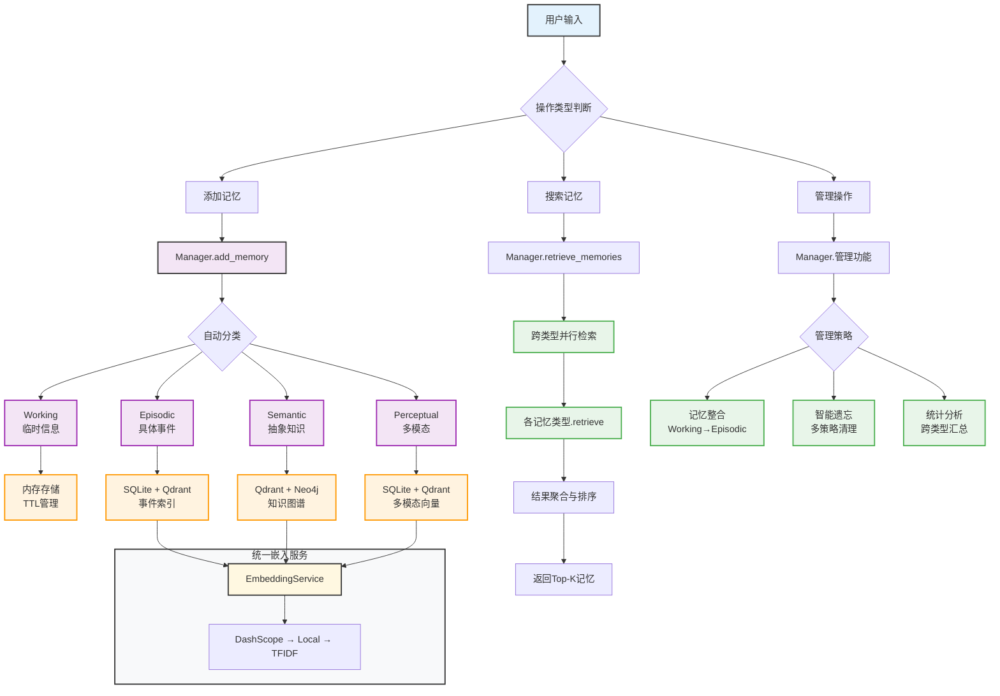
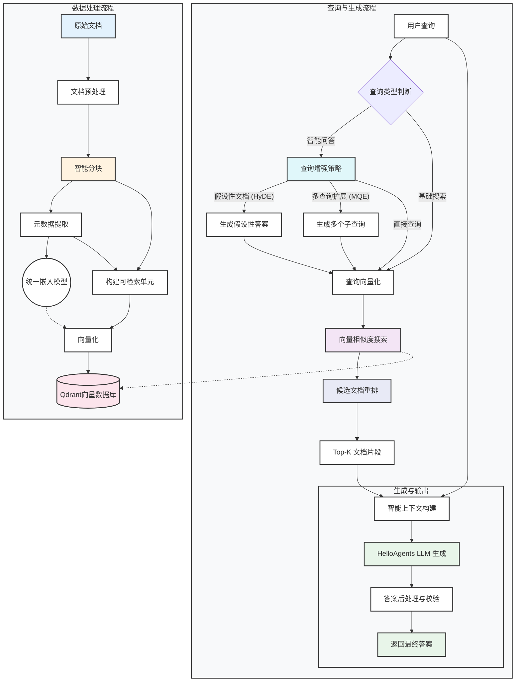
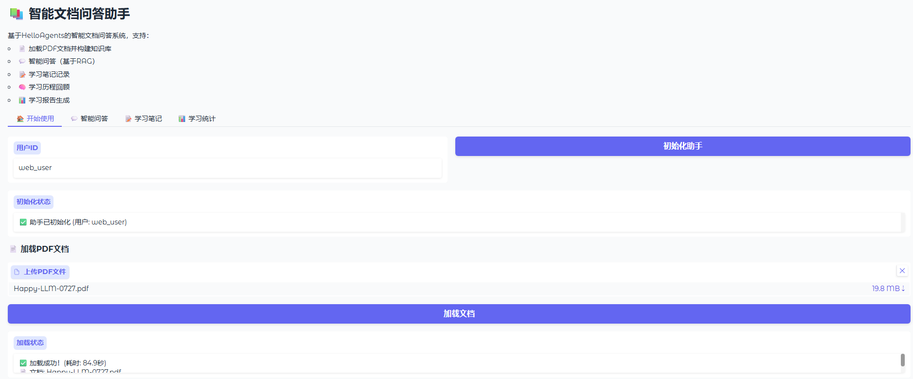
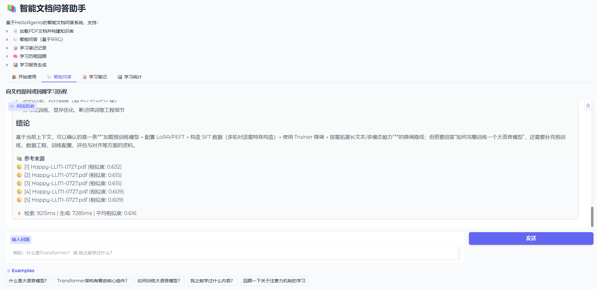
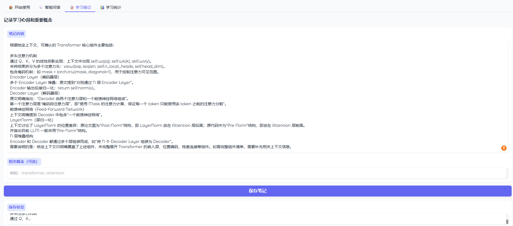
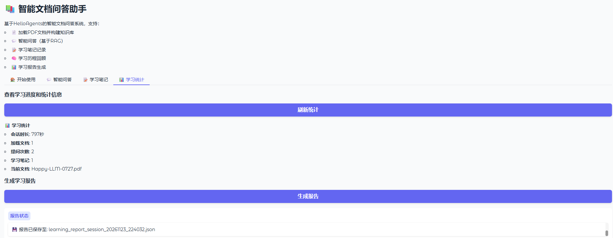

# Hello Agents 进阶篇打卡记录-Task3

课程链接：[Hello Agents](https://github.com/datawhalechina/Hello-Agents)

## 任务

- 第八章
- 章后习题

## 笔记-第八章 记忆与检索

### 从认知科学到智能体记忆

第七章只是让 agent 可以记住用户在同一轮会话中的上下文，程序重跑的时候就会全部重置

同时，LLM 的输入上下文长度虽然现在已经不断扩展，但是终究有上限。在应对上下文的问题的时候，有些模式也需要记忆的参与

另外像 Skill 之类的，本质上也可以看作有记忆的参与

其次，LLM 内置的知识有一定局限，完全来自于训练数据，如果有独特的知识需要它来回答的时候，一般来说很难做到

所以想要真的让 agent 能够更加智能，更加完善地运转，还需要记忆系统

HelloAgents 的记忆系统的四层结构：
```
HelloAgents记忆系统
├── 基础设施层 (Infrastructure Layer)
│   ├── MemoryManager - 记忆管理器（统一调度和协调）
│   ├── MemoryItem - 记忆数据结构（标准化记忆项）
│   ├── MemoryConfig - 配置管理（系统参数设置）
│   └── BaseMemory - 记忆基类（通用接口定义）
├── 记忆类型层 (Memory Types Layer)
│   ├── WorkingMemory - 工作记忆（临时信息，TTL管理）
│   ├── EpisodicMemory - 情景记忆（具体事件，时间序列）
│   ├── SemanticMemory - 语义记忆（抽象知识，图谱关系）
│   └── PerceptualMemory - 感知记忆（多模态数据）
├── 存储后端层 (Storage Backend Layer)
│   ├── QdrantVectorStore - 向量存储（高性能语义检索）
│   ├── Neo4jGraphStore - 图存储（知识图谱管理）
│   └── SQLiteDocumentStore - 文档存储（结构化持久化）
└── 嵌入服务层 (Embedding Service Layer)
    ├── DashScopeEmbedding - 通义千问嵌入（云端API）
    ├── LocalTransformerEmbedding - 本地嵌入（离线部署）
    └── TFIDFEmbedding - TFIDF嵌入（轻量级兜底）
```

HelloAgents 的 RAG 系统
```
HelloAgents RAG系统
├── 文档处理层 (Document Processing Layer)
│   ├── DocumentProcessor - 文档处理器（多格式解析）
│   ├── Document - 文档对象（元数据管理）
│   └── Pipeline - RAG管道（端到端处理）
├── 嵌入表示层 (Embedding Layer)
│   └── 统一嵌入接口 - 复用记忆系统的嵌入服务
├── 向量存储层 (Vector Storage Layer)
│   └── QdrantVectorStore - 向量数据库（命名空间隔离）
└── 智能问答层 (Intelligent Q&A Layer)
    ├── 多策略检索 - 向量检索 + MQE + HyDE
    ├── 上下文构建 - 智能片段合并与截断
    └── LLM增强生成 - 基于上下文的准确问答
```

### 记忆系统：让智能体拥有记忆

根据认知科学的研究，人类记忆的形成经历以下几个阶段：

- 编码（Encoding）：将感知到的信息转换为可存储的形式
- 存储（Storage）：将编码后的信息保存在记忆系统中
- 检索（Retrieval）：根据需要从记忆中提取相关信息
- 整合（Consolidation）：将短期记忆转化为长期记忆
- 遗忘（Forgetting）：删除不重要或过时的信息

HelloAgents 的记忆系统


按操作分为添加、检索和管理

添加记忆的时候配合了数据库和内存做了记忆存储
- SQLite: 关系型数据库，负责按条件精准搜索
- Qdrant: 向量数据库，负责语义搜索
- Neo4j: 图数据库，负责知识图谱搜索
- TTL 管理：Time To Live 的缩写，指一条数据的存活时间，在临时信息存储的时候和内存搭配使用

关于抽象知识：

我的认知中知识图谱是在以下的情境下比较能发挥作用
- 大量的零散数据中抽取关联知识
- 知识的层级比较多（检索的时候需要多步检索）

如果单从对话中提取，感觉需要长期积累，并且需要根据用户情况更新

#### 添加记忆

1. 获取当前会话 ID
2. 如果是多模态信息且写了文件地址
   1. 如果有传文件类型就直接用
   2. 没有传就按照文件地址的信息解析文件类型
3. 把会话 ID 和时间戳加到 `metadata` 里
4. 创建记忆并添加，包含以下参数
   1. 内容
   2. 记忆类型
   3. 重要程度（为了后续管理时候做判断用的，可以指定，也可能用默认值或者按规则计算）
   4. `metadata`
   5. `auto_classify` : 是否自动分类，默认为 `True`

#### 搜索记忆

返回一个带有记忆类型和重要程度的记忆预览，并且可以按照重要程度筛选掉不重要的记忆

#### 管理记忆

**遗忘**

- 基于重要性（删除不重要的记忆）
- 基于时间（删除过时的记忆）
- 基于容量（当存储接近上限时删除最不重要的记忆）

**整合**

默认设置是将重要性超过 0.7 的 Working 记忆转化为 Episodic 记忆

也可以自定义重要性门槛

#### 四种记忆类型

##### 工作记忆（WorkingMemory）

负责存储当前对话会话中的临时信息，可以快速访问和自动清理（TTL）

搜索时使用 TF-IDF 词项权重相似度 × 0.7 + 关键词匹配 × 0.3 得到相关性分数

再按时间衰减相关性分数（越旧分数越低）

之后再按 (0.8 + 重要性 × 0.4) 算权重

最终公式为 `(相关性 × 时间衰减) × (0.8 + 重要性 × 0.4)`

> TF-IDF 词项权重相似度：
> - TF（词频）：一个词在这条文本里出现的次数。出现得越多，权重越高。
> - IDF（逆文档频率）：一个词在越多条文本里出现过，权重越低。“用户”“喜欢”这种到处都有的词，几乎不能用来区分文本。“咖啡”这种只在少数文本里出现的词，权重就高。
> - TF × IDF：两者相乘，得到每个词在这条文本里的权重

##### 情景记忆（EpisodicMemory）

长期记忆的一种，不自动清除，使用 SQLite + Qdrant 的混合存储方案，支持向量查询

查询结果按评分降序排列，评分公式 `(向量相似度 × 0.8 + 时间近因性 × 0.2) × (0.8 + 重要性 × 0.4)`

##### 语义记忆（SemanticMemory）

采用了 Neo4j 图数据库和 Qdrant 向量数据库的混合架构

存储的时候先用嵌入模型向量化预处理，之后抽取实体和关系存到 Neo4j 图数据库中，再把向量、实体和关系存到 Qdrant 向量数据库中

搜索的时候采用了向量搜索和图搜索的混合排序，公式为 `(向量相似度 × 0.7 + 图相似度 × 0.3) × (0.8 + 重要性 × 0.4)`，当向量搜索或者图搜索没有该记忆时，相应得分为 0

##### 感知记忆（PerceptualMemory）

支持文本、图像、音频等多种模态的数据存储和检索，采用模态分离的存储策略，这样避免了维度不匹配的问题

检索支持同模态和跨模态两种模式，同模态检索利用专业的编码器进行精确匹配，而跨模态检索则需要更复杂的语义对齐机制

评分公式 `(向量相似度 × 0.8 + 时间近因性 × 0.2) × (0.8 + 重要性 × 0.4)`

### RAG系统：知识检索增强

检索增强生成，就是通过向量搜索提前查找出相关片段放入 prompt 中，帮助 LLM 提高生成质量



主要有两个部分，一个是数据处理（采取工具 MarkItDown，设计思路是将传入的一切外部知识源统一转化为 Markdown 格式进行处理），一个是检索和生成

#### RAG系统架构设计

```
用户层：RAGTool统一接口
  ↓
应用层：智能问答、搜索、管理
  ↓  
处理层：文档解析、分块、向量化
  ↓
存储层：向量数据库、文档存储
  ↓
基础层：嵌入模型、LLM、数据库
```

##### 多模态文档载入

使用 MarkItDown 将常见文档格式转换为 Markdown

支持格式：
- 文档：PDF、Word、Excel、PowerPoint
- 图像：JPG、PNG、GIF（通过OCR）
- 音频：MP3、WAV、M4A（通过转录）
- 文本：TXT、CSV、JSON、XML、HTML
- 代码：Python、JavaScript、Java等

##### 智能分块策略

Markdown 结构感知的分块流程：

```
标准Markdown文本 → 标题层次解析 → 段落语义分割 → Token计算分块 → 重叠策略优化 → 向量化准备
       ↓                ↓              ↓            ↓           ↓            ↓
   统一格式          #/##/###        语义边界      大小控制     信息连续性    嵌入向量
   结构清晰          层次识别        完整性保证    检索优化     上下文保持    相似度匹配
```
同时为了兼容不同语言，系统实现了针对中英文混合文本的Token估算算法

##### 统一嵌入与向量存储

将文本转换为高维向量，使得计算机能够理解和比较文本的语义相似性

RAG 系统的检索能力很大程度上取决于嵌入模型的质量和向量存储的效率

##### 高级检索策略

**多查询扩展（MQE）**

通过生成语义等价的多样化查询来提高检索召回率

也就是说一个语句换多种说法，来提高匹配广度从而提高准确性，这对模糊查询有帮助

通过要求 LLM 多生成几个查询关键词实现

**假设文档嵌入（HyDE）**

先立靶子，先假设出来一个答案，再根据这个答案查找，这样解决了因为问题是疑问句而答案是陈述句带来的语义空间分布差距问题，假设回答中使用的语句风格能给查询带来一定的帮助，对于专业术语类型的查询比较有帮助

通过要求 LLM 先写一个假设回答实现

**扩展检索框架**

将上边两种增强策略开放给用户自行选择，对于需要尽可能全的收集候选文档的（高召回率）进行组合检索，对于性能敏感的场景可以只用基础检索

先做扩展查询，获取候选文档池，再去重并且根据分数排序整合，最终返回 top-k

#### 构建智能文档问答助手

功能：
- 智能文档处理：PDF -> Markdown，并且智能分块，向量化和索引构建
- 高级检索问答：多查询扩展（MQE）和假设文档嵌入（HyDE）改善精度
- 多层次记忆管理：
  - 工作记忆管理当前学习任务和上下文
  - 情景记忆记录学习事件和查询历史
  - 语义记忆存储概念知识和理解
  - 感知记忆处理文档特征和多模态信息
- 个性化学习支持：基于学习历史的个性化推荐，记忆整合和选择性遗忘，学习报告生成和进度追踪


这个应用分为三个核心部分：

1. 核心助手类（PDFLearningAssistant）：封装RAGTool和MemoryTool的调用逻辑
2. Gradio Web界面：提供友好的用户交互界面，这个部分可以参考示例代码学习
3. 其他核心功能：笔记记录、学习回顾、统计查看和报告生成

##### 核心助手类（PDFLearningAssistant）

**类的初始化**

初始化了
- `user_id` : 隔离用户
- `session_id`
- 工具
- `stats` : 学习统计，包括 session，加载文档，提问和已学内容，用于生成学习报告
- 当前加载的文档

**加载PDF文档**

使用 RAGTool 进行 Markdown 转换以及分块和向量化

并把这一步加到情景记忆中，因为这一步可以在后续的学习统计的时候提供记录依据

##### 智能问答功能

用户提问，agent 先把提问记录写进工作记忆里（为了保存会话记录）

再用 `rag_tool` 查询答案，并把这步查询加载到情景记忆中（连带问题一起）

##### 其他核心功能

- 笔记记录：在语义记忆里添加一条记录，可以用 `concept` 加标签（但是代码没用到），并计数一次学习进 `stats`
- 学习回顾：查找相关学习记录
- 统计查看：获取 `stats`
- 生成学习报告：总结记忆内容，并根据 `stats` 内容生成报告

##### 运行结果

初始化和加载文档



智能问答



学习笔记



学习报告



## 习题

1. 本章介绍了四种记忆类型：工作记忆、情景记忆、语义记忆和感知记忆。请分析：

   - 在8.2.5节中，每种记忆类型都有独特的评分公式。请对比情景记忆和语义记忆的评分机制，解释为什么情景记忆更强调"时间近因性"（权重0.2），而语义记忆更强调"图检索"（权重0.3）？
     - 因为这两个记忆的侧重点就不一样，情景记忆是按时间序列排列的，按照人类的思维方式，通常最新的消息可信度就稍微高一些。而语义记忆本身就比较依赖图检索，并且在检索很久以前的知识方面应该比较擅长，所以图检索的权重就会高一些
   - 如果要设计一个"个人健康管理助手"（需要记录用户的饮食、运动、睡眠数据，并提供健康建议），你会如何组合使用这四种记忆类型？请为每种记忆类型设计具体的应用场景。
     - 工作记忆：保存当前会话信息时使用
     - 情景记忆：保存用户的饮食、运动、睡眠数据使用
     - 语义记忆：在记录的时候定期分析用户的特征和行为习惯，保存为实体和关系
     - 感知记忆：在用户拍照记录今天的饭或者截图睡眠记录等图片信息的时候使用
   - 工作记忆采用TTL（Time To Live）机制自动清理过期数据。请思考：在什么情况下，重要的工作记忆应该被"整合"（consolidate）为长期记忆？如何设计一个自动整合的触发条件？
     - 当有一条记忆要被存入情景记忆的时候，应该在工作记忆中查找相关对话，寻找重要度，相关性高的记忆进行整合

2. 在8.3节的RAG系统中，我们使用MarkItDown将各种格式文档统一转换为Markdown。请深入思考：

   > <strong>提示</strong>：这是一道动手实践题，建议实际操作

   - 当前的智能分块策略基于Markdown的标题层次（#、##、###）进行分割。如果处理的是没有明确标题结构的文档（如小说、法律条文），应该如何优化分块策略？请尝试实现一个基于"语义边界"的分块算法。
     - （未完成）
   - 在8.3.5节中介绍了MQE（多查询扩展）和HyDE（假设文档嵌入）两种高级检索策略。请选择一个实际场景（如技术文档问答、医疗知识检索），对比基础检索、MQE和HyDE三种方法的效果差异，并分析各自的适用场景。
     - （未完成）
   - RAG系统的检索质量很大程度上取决于嵌入模型的选择。请对比本章提到的三种嵌入方案（百炼API、本地Transformer、TF-IDF），从准确性、速度、成本、离线部署等维度进行评估，并给出选型建议。

      | 维度       | 百炼 API（text-embedding-v3） | 本地 Transformer（all-MiniLM-L6-v2）   | TF-IDF                       |
      | ---------- | ----------------------------- | -------------------------------------- | ---------------------------- |
      | 匹配方式   | 稠密向量，按语义匹配          | 稠密向量，按语义匹配                   | 稀疏词项向量，按字面匹配     |
      | 运行位置   | 云端                          | 本机                                   | 本机                         |
      | 中文准确性 | 高                            | 偏低，模型用英文语料训练               | 低，“报销”搜不到“费用申请”   |
      | 英文准确性 | 高                            | 中上                                   | 低，只有关键词一致时才能命中 |
      | 输入长度   | 单条最长 8192 token           | 超过 256 个 word piece 的部分被截断    | 无限制                       |
      | 向量维度   | 默认 1024，可选更低           | 固定 384                               | 等于词表大小，随语料变化     |
      | 速度       | 受网络延迟影响                | CPU 上单条毫秒级                       | 最快                         |
      | 成本       | 按 token 计费                 | 没有调用费，占用本机 CPU 和内存        | 几乎为零                     |
      | 部署       | 只要 API Key，必须联网        | 首次运行下载约 90MB 模型，之后可以离线 | 不需要模型，可以离线         |
      | 数据隐私   | 文本会发到云端                | 文本留在本机                           | 文本留在本机                 |
      - 普通学习做原型用百炼就行，中文效果好，也不要求硬件
      - 数据要求保密，或者使用量大，用本地 Transformer
      - 装不了 PyTorch，或只检索编号、型号、专有名词，用 TF-IDF

3. 记忆系统的"遗忘"机制是模拟人类认知的重要设计。基于8.2.3节的MemoryTool，请完成以下扩展实践：

   > <strong>提示</strong>：这是一道动手实践题，建议实际操作

   - 当前提供了三种遗忘策略：基于重要性、基于时间、基于容量。请设计并实现一个"智能遗忘"策略，综合考虑重要性、访问频率、时间衰减等多个因素，使用加权评分来决定哪些记忆应该被遗忘。
     - （未完成）
   - 在长期运行的智能体系统中，记忆数据库可能会积累大量数据。请设计一个"记忆归档"机制：将长期不用但可能有价值的记忆转移到冷存储，需要时再恢复。这个机制应该如何与现有的四种记忆类型集成？
     - （未完成）
   - 思考：如果智能体需要"忘记"某些敏感信息（如用户隐私数据），仅仅从数据库删除是否足够？在使用向量数据库和图数据库的情况下，如何确保数据被彻底清除？
     - （未完成）

4. 在8.4节的"智能学习助手"案例中，我们结合了MemoryTool和RAGTool。请深入分析：

   - 案例中的`ask_question()`方法同时使用了RAG检索和记忆检索。请分析：在什么情况下应该优先使用RAG？在什么情况下应该优先使用Memory？如何设计一个"智能路由"机制来自动选择最合适的检索方式？
     - 在用户问题的答案在上传的资料里可以找到的时候用 RAG，用户提问和过去对话相关用记忆检索
     - 大概有几种方案，这几种方案可以组合使用
       - 给两种检索方式各准备几个问法，提前转化成向量，程序先计算一遍当前问题的向量相似度，相似度超过阈值采用，问题是准确度不高，只能大致判断
       - 让 LLM 直接通过这两个工具的描述自己选，问题是增加使用量
       - 使用决策模型判断，问题是要再接一种模型
   - 当前的学习报告（`generate_report()`）只包含统计信息。请扩展这个功能，设计一个更智能的学习报告生成器：能够分析用户的学习轨迹、识别知识盲点、推荐下一步学习内容。这需要用到哪些记忆类型和检索策略？
     - 学习轨迹：情景记忆和语义记忆，把用户学习内容和时间戳提取出来，可以用到多查询扩展，识别出用户对一个知识点的不同说法
     - 知识盲点：使用语义记忆和文档的切块，查找切块中涵盖的知识点但是语义记忆中没有的，用向量相似度（总共的减去有的）
     - 推荐下一步学习：找出学习轨迹最新的学习记录的知识点，看和知识盲点哪些在一个父块下，或者用假设性文档嵌入要求给出一个假定结果，再看知识文档中有没有
   - 假设你要将这个学习助手部署为多用户的Web服务，每个用户都有独立的记忆和知识库。请设计数据隔离方案：如何在 Qdrant 和 Neo4j 中实现用户级别的数据隔离？如何优化多用户场景下的检索性能？
     - Qdrant：每个点的 payload 里写入用户 ID，查询时可以用过滤器按用户隔离
     - Neo4j：按用户 ID 划分命名空间，给每个节点标记用户 ID，查询起点也带上用户 ID
     - Qdrant 创建 payload 索引的时候设置 `is_tenant=True`，会把同一个租户的点在磁盘上放在一起，搜索时效率更高。高级检索策略尽量少用，因为需要调用 LLM，效率和开销都不算太好

5. 语义记忆使用了Neo4j图数据库来存储知识图谱。请思考：

   - 在8.2.5节的语义记忆实现中，系统会自动提取实体和关系构建知识图谱。请分析：这种自动提取的准确性如何？在什么情况下可能会提取出错误的实体或关系？如何设计一个"知识图谱质量评估"机制？
     - spaCy 识别出来的实体大多和技术概念中真正想被识别出来的实体不太一样。关系太简单，只记录提到过，没有支持、反对等语义关系
     - 语义有歧义的时候
     - 看抽出的关系是否有意义，要全是 CO_OCCURS 就没有意义，看结点是否语义相似（向量相似）或者只是大小写差别，是的话就很多无用结点
   - 知识图谱的一个重要优势是支持复杂的关系推理。请设计一个查询场景，充分利用Neo4j的图查询能力（如多跳关系、路径查找），实现纯向量检索无法完成的任务。
     - 在一个课题讨论的会议中，找出当前发言人最终结论能够解决的课题，比如产品 A 的推广效果不是很理想，并且销量不好，还会被说 bug 多，如果最终结论的一条是修改使用说明，按语义有可能被分到改善 bug 里边去，但是如果抽取出 `使用说明-(降低)->上手难度-(提高)->推广能力` 就可以正确分类
   - 对比语义记忆的"向量检索+图检索"混合策略与纯向量检索：在什么类型的查询中，图检索能够带来显著的性能提升？请用具体例子说明。
     - 上一题感觉就差不多了


