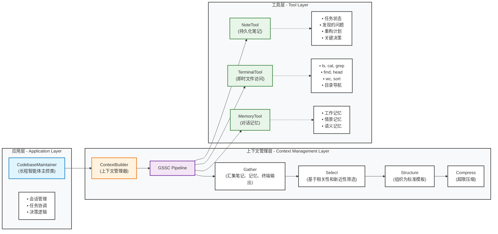

# Hello Agents 进阶篇打卡记录-Task4

课程链接：[Hello Agents](https://github.com/datawhalechina/Hello-Agents)

## 任务

- 第九章
- 章后习题

## 笔记-第九章 上下文工程

### 为什么上下文工程重要

LLM 的上下文是有限的，并且上下文越长，注意力会被分散，模型表现会越差，也就是上下文腐蚀（context rot）

前几章的工具需要 LLM 根据名字和描述来选择，记忆也需要提示给 LLM，让模型进行参照查找

所以随着运行时间的增长，积累起来的需要提示给 LLM 的东西会越来越多，如果不进行上下文管理，可能单单背景就占满了上下文，又或者 LLM 能力因为需要处理的东西太多而降低

#### 有效上下文的“解剖学”

优秀的上下文工程目标是：用尽可能少、但高信号密度的 tokens，最大化获得期望结果的概率

- 系统提示（System Prompt）：清晰、直白，能完整勾勒期望行为的“最小必要信息集”
- 工具（Tools）：
  - 职责单一、相互低重叠，接口语义清晰
  - 对错误鲁棒
  - 入参描述明确、无歧义，充分发挥模型擅长的表达与推理能力
- 示例（Few-shot）：请精挑细选一组多样且典型的示例，直接画像“期望行为”（但是个人建议尽量不要选择有倾向的示例，比如要选择对错的情况下，结果是对和结果是错的最好都有）

#### 上下文检索与智能体式搜索

工程实践正在从“推理前一次性检索（embedding 检索）”逐步过渡到“及时（Just-in-time, JIT）上下文”

> 引用的元数据本身也能帮助精化行为：目录层级、命名约定、时间戳等都在隐含地传达“目的与时效”。例如，tests/test_utils.py 与 src/core/test_utils.py 的语义暗示就不同。

也就是说把查询的目录留下，需要的时候调用工具去读取，使用渐进式披露

但是这需要在设计的时候让工具和目录还有命名这类的起到引导作用，并且多一层渐进，就意味着模型需要多思考一步，多消耗一步的 token 和时间，并且一旦选错，那么后边结果就有可能出错，或者造成浪费

所以最近微软推出的 TokenEconomizer 就包括了对反复失败的介入（判断 agent 卡住后提示换一种做法），来达到减少 token 消耗的目的

#### 面向长时程任务的上下文工程

- 压缩整合（Compaction）：对上下文进行总结，但是有可能会丢失重要信息，所以要先优化召回，减少遗漏，再提高精度
- 结构化笔记（Structured note-taking）：也称“智能体记忆”，把信息写入长期保存的文件，按需求搜索
- 子代理架构（Sub-agent architectures）：把任务分派给上下文隔离的子代理，把中间过程省略，只返回给主代理结果，但是这样会增加 token 的消耗，最好开之前能够评估当前任务是否值得开子代理

### 在 Hello-Agents 中的实践：ContextBuilder

- 统一入口：将"获取(Gather)- 选择(Select)- 结构化(Structure)- 压缩(Compress)"抽象为可复用 GSSC 流水线
- 稳定形态：输出固定骨架的上下文模板，便于调试、A/B 测试与评估
  - `[Role & Policies]`：明确 Agent 的角色定位和行为准则
  - `[Task]`：当前需要完成的具体任务
  - `[State]`：Agent 的当前状态和上下文信息
  - `[Evidence]`：从外部知识库检索的证据信息
  - `[Context]`：历史对话和相关记忆
  - `[Output]`：期望的输出格式和要求
- 预算守护：在 token 预算内尽量保留高价值信息，对超限上下文提供兜底压缩策略
- 最小规则：不引入来源/优先级等分类维度，避免复杂度增长

#### 核心数据结构

**ContextPacket：候选信息包**

- `content`: 信息内容
- `timestamp`: 时间戳
- `token_count`: Token 数量
- `relevance_score`: 相关性分数(0.0-1.0)
- `metadata`: 可选的元数据

**ContextConfig：配置管理**

- `max_tokens`: 最大 token 数量
- `reserve_ratio`: 为系统指令预留的比例(0.0-1.0)
- `min_relevance`: 最低相关性阈值
- `enable_compression`: 是否启用压缩
- `recency_weight`: 新近性权重(0.0-1.0)
- `relevance_weight`: 相关性权重(0.0-1.0)

#### GSSC 流水线详解

**Gather：多源信息汇集**

- 添加系统指令到 ContextPacket（始终保留，用 `metadata` 的 `type` 做区分）
- 从记忆中检索当前对话相关记忆，存到 ContextPacket
- 从 RAG 检索相关知识，存到 ContextPacket
- 添加最近对话历史（默认窗口大小为5）
- 也可以自定义再加点什么进 ContextPacket

添加的时候使用 try-except，一个失败也不影响其他的添加

**Select：智能信息选择**

根据相关性和新近性对候选信息进行评分和选择

- 将系统指令分离出来单独计算占用 token 数
- 其他的信息计算综合分数
  - 计算相关性：生产环境中，可以替换为向量相似度计算
  - 计算新近性：使用指数衰减模型，24小时内保持高分，之后逐渐衰减
  - 综合分数 = 相关性权重 × 相关性 + 新近性权重 × 新近性
  - 过滤低于最小相关性阈值的信息
  - 降序排序
- 贪心选择：按分数从高到低填充，直到达到 token 上限

**Structure：结构化输出**

靠 `metadata` 的 `type` 做区分

- `[Role & Policies]`：明确 Agent 的角色定位和行为准则
- `[Task]`：当前需要完成的具体任务
- `[State]`：Agent 的当前状态和上下文信息
- `[Evidence]`：从外部知识库检索的证据信息
- `[Context]`：历史对话和相关记忆
- `[Output]`：期望的输出格式和要求

**Compress：兜底压缩**

可以使用 LLM 摘要，但要提前划分好区块，分区压缩，保持结构完整性，这样可以一定程度上保证信息的完整性

#### 最佳实践

- 动态调整 token 预算：简单任务使用较小预算，复杂任务增加预算
- 相关性计算优化：将简单的关键词重叠替换为向量相似度计算，提升检索质量
- 缓存机制：对于不变的系统指令和知识库内容，可以实现缓存机制，避免重复计算
- 监控与日志：记录每次上下文构建的统计信息，便于后续优化
- A/B 测试：对于关键参数，通过 A/B 测试找到最优配置

### NoteTool：结构化笔记

- 结构化记录：使用 Markdown + YAML 格式，既适合机器解析，也方便人类阅读和编辑
- 版本友好：纯文本格式，天然支持 Git 等版本控制系统
- 低开销：无需复杂的数据库操作，适合轻量级的状态追踪
- 灵活分类：通过 type 和 tags 灵活组织笔记，支持多维度检索

适用场景：
- 需要长期记录进度和各个指标
- 需要产出报告或者记笔记
- 和 ContextBuilder 配合，作为长期记忆的一种

#### 存储格式详解

- 笔记文件格式：Markdown
- 索引文件：维护一个 `notes_index.json` 文件，作为笔记目录

#### 核心操作详解

**create：创建笔记**

1. 生成 ID：带时间戳的文件名
2. 构建 `metadata`：`id`，`title`，`type`，`tags`，`created_at`，`updated_at`
3. 构建 Markdown 文件内容并保存
4. 更新索引

**read：读取笔记**

读取并解析，分离 YAML 和正文

**update：更新笔记**

更新标题、内容、类型和标签（默认更新时间戳和索引）

**search：搜索笔记**

可以按类型和标签过滤

**list：列出笔记**

用 index 文件列出笔记列表

**summary：笔记摘要**

统计笔记个数和各个类型的个数，并列出最近更新的 5 条笔记

**delete：删除笔记**

删除笔记文件和索引中的项目

#### 最佳实践

1. 合理的笔记分类：
   - `task_state`：记录阶段性进展和状态
   - `conclusion`：记录重要的结论和发现
   - `blocker`：记录阻塞问题，优先级最高
   - `action`：记录下一步行动计划
   - `reference`：记录重要的参考资料
2. 定期清理和归档：
   - 对于已解决的 blocker，更新为 conclusion
   - 对于过时的 action，及时删除或更新
   - 使用 tags 进行版本管理，如 `["v1.0", "completed"]`
3. 与 ContextBuilder 的配合：
   - 在每轮对话前检索相关笔记
   - 根据笔记类型设置不同的相关性分数(blocker > action > conclusion)
   - 限制笔记数量，避免上下文过载
4. 人机协作：
   - 笔记是人类可读的 Markdown 格式，支持手动编辑
   - 使用 Git 进行版本控制，追踪笔记的演化
   - 在关键阶段，人工审核 Agent 生成的笔记
5. 自动化工作流：
   - 定期生成笔记摘要报告
   - 基于笔记自动生成项目进度文档
   - 将笔记内容同步到其他系统(如 Notion、Confluence)

### TerminalTool：即时文件系统访问

让 Agent 通过执行命令行命令实现访问计算机上的文件

好处：可以实现之前提到的即时上下文，渐进式披露

坏处：有严重的安全隐患，把计算机中的文件暴露在随时可能被误删的风险下，并且还可能访问到机密文件

安全机制
- 命令白名单：只允许安全的只读命令，完全禁止任何可能修改系统的操作
  ```python
  ALLOWED_COMMANDS = {
      # 文件列表与信息
      'ls', 'dir', 'tree',
      # 文件内容查看
      'cat', 'head', 'tail', 'less', 'more',
      # 文件搜索
      'find', 'grep', 'egrep', 'fgrep',
      # 文本处理
      'wc', 'sort', 'uniq', 'cut', 'awk', 'sed',
      # 目录操作
      'pwd', 'cd',
      # 文件信息
      'file', 'stat', 'du', 'df',
      # 其他
      'echo', 'which', 'whereis',
  }
  ```
- 工作目录限制(沙箱)
- 超时控制，防止无限耗用资源
- 输出大小限制，限制命令输出的大小，防止内存溢出

#### 核心功能详解

**命令执行**

用 `subprocess.run` 执行命令，如果返回中报错的话也拼一起返回
```python
def _execute_command(self, command: str) -> str:
    """执行命令"""
    try:
        # 在当前目录下执行命令
        result = subprocess.run(
            command,
            shell=True,
            cwd=str(self.current_dir),  # 在当前工作目录执行(沙箱)
            capture_output=True,
            text=True,
            timeout=self.timeout,       # 超时控制
            env=os.environ.copy()
        )

        # 合并标准输出和标准错误
        output = result.stdout
        if result.stderr:
            output += f"\n[stderr]\n{result.stderr}"

        # 检查输出大小(输出大小限制)
        if len(output) > self.max_output_size:
            output = output[:self.max_output_size]
            output += f"\n\n⚠️ 输出被截断（超过 {self.max_output_size} 字节）"

        # 添加返回码信息
        if result.returncode != 0:
            output = f"⚠️ 命令返回码: {result.returncode}\n\n{output}"

        return output if output else "✅ 命令执行成功（无输出）"

    except subprocess.TimeoutExpired:
        return f"❌ 命令执行超时（超过 {self.timeout} 秒）"
    except Exception as e:
        return f"❌ 命令执行失败: {e}"
```

**目录导航**

cd 命令的特殊处理支持智能体在文件系统中进入不同目录
- 处理相对路径
- 检查处理完的路径是否脱离了工作目录（脱离的话返回一个报错信息）
- 检查路径目录是否存在
- 更新 `self.current_dir` 为当前路径

#### 典型使用模式

- 探索式导航
  1. 查看项目根目录
  2. 查看源码目录结构
  3. 搜索特定模式（grep）
- 数据文件分析：快速了解数据文件的结构和内容（可以统计和查看 csv）
- 日志文件分析：可以按日期查找，统计错误类型等等
- 代码库分析：辅助代码审查和理解

#### 与其他工具的协同

- MemoryTool：TerminalTool 发现的信息可以存储到记忆系统中
- NoteTool：重要的发现可以记录为结构化笔记
- ContextBuilder：TerminalTool 的输出可以作为上下文的一部分

### 长程智能体实战：代码库维护助手



整合 ContextBuilder + NoteTool + TerminalTool + MemoryTool，实现跨会话的代码库维护任务管理
1. 按运行模式加载背景信息
   - `auto`: 自动决策是否使用工具，和 `explore` 使用同一套逻辑
   - `explore`: 侧重代码探索，把代码结构目录交给 LLM
   - `analyze`: 侧重问题分析，把代码统计和其中标记的 TODO 和 FIXME 交给 LLM
   - `plan`: 侧重任务规划，把最近 3 条任务状态笔记（`task_state`）的标题交给 LLM
2. 搜索相关笔记，根据笔记类型设置不同的相关性分数
3. 构建优化的上下文，根据运行模式选择不同的系统指令
   - `auto`: 要求系统进行自动决策选择工具
   - `explore`: 要求系统侧重代码探索，主动了解代码结构并记录
   - `analyze`: 要求系统侧重问题分析，查找代码中的 TODO 和 FIXME，评估代码质量并记录
   - `plan`: 要求系统侧重任务规划，回顾历史笔记，制定下一步规划并更新状态
4. 调用 LLM
5. 后处理
   - 机械识别 LLM 回复中的 `"问题", "bug", "错误", "阻塞"` 等词语，创建问题笔记（`blocker`）
   - 没有识别到上面的词语时，机械识别用户输入中的 `"计划", "下一步", "任务", "todo"` 等词语，创建任务计划笔记（`action`）
6. 更新历史对话

## 习题

1. 本章介绍了上下文工程与提示工程的区别。请分析：

   - 在9.1节中提到"上下文必须被视作一种有限资源，且具有边际收益递减"。请解释什么是"上下文腐蚀"（context rot）现象？为什么即使模型支持100K甚至200K的上下文窗口，我们仍然需要谨慎管理上下文？
     - 因为不管 LLM 的上下文窗口支持到多大，一次性塞太多东西进上下文，会稀释模型的注意力导致能力下降。更不要说上下文质量不佳的情况，会很影响模型输出。
   - 假设你要构建一个"代码审查助手"，需要分析一个包含50个文件的代码库。请对比两种策略：（1）一次性将所有文件内容加载到上下文中；（2）使用JIT（Just-in-time）上下文，通过工具按需检索文件。分析各自的优缺点和适用场景。
     - 第一种
       - 优点：不用来回调用工具读取文件，效率会提高
       - 缺点：文件太多，会导致上下文腐蚀
     - 第二种
       - 优点：渐进式披露，让上下文在一个可控的范围内
       - 缺点：需要调用工具来回读取文件，如果找到了错误的文件，还会重新找，增加消耗
   - 在9.2.1节中提到系统提示的两个极端误区："过度硬编码"和"过于空泛"。请各举一个实际例子，并说明如何找到合适的平衡点。
     - 过度硬编码：在代码解说的时候
         ```
         如果问题里有"是干什么的"或"什么意思"，找到对应的函数，逐行解释。
         如果问题里有"在哪"或"哪个文件"，执行 grep -rn "<名称>" .，原样返回结果。
         如果问题里有"调用流程"或"怎么调用"，从 main 函数开始，按调用顺序列出函数。
         如果问题里有"为什么"，回答"这样设计是为了解耦，便于扩展和维护"。
         如果问题里有"报错"或"Error"，回复"请贴出完整的报错信息"。
         如果问题里有"怎么运行"，回复"先执行 pip install -r requirements.txt，再执行 python main.py"。
         以上都不符合时，回复"请说明你想了解哪个函数"。
         ```
       这样的话，如果是 Java 项目，模型就不知道怎么办了
     - 过于空泛：在代码解说的时候
       ```
       你是一个代码专家，请用通俗易懂的方式回答用户的问题
       ```
     - 平衡：
       - 写规则但是不写具体触发词
       - 写出模型不可能自己知道的信息
       - 文件只告诉地址，让 Agent 自己查询
       - 把背景、问题、查找方法、要求告诉模型

2. GSSC（Gather-Select-Structure-Compress）流水线是本章的核心技术。请深入思考：

   > <strong>提示</strong>：这是一道动手实践题，建议实际操作

   - 在9.3节的ContextBuilder实现中，四个阶段各有不同的职责。请分析：如果某个阶段失效（如Select阶段选择了不相关的信息，或Compress阶段过度压缩导致信息丢失），会对最终的智能体表现产生什么影响？
     - Gather：如果收集的上下文遗漏了重要信息，会导致最终输出结果看着像遗忘了用户过去的要求
     - Select：如果选择了不相关的信息，会导致上下文腐蚀降低输出质量
     - Structure：如果没有结构化信息，能力强的模型的话应该影响不会太大，会在思考的时候多消耗一些时间和 token 来整理信息，但是能力不强的模型会直接影响输出质量
     - Compress：如果过度压缩导致信息丢失，会导致模型无法回答丢失信息的相关问题
   - 请基于9.3.4节的代码，为ContextBuilder添加一个"上下文质量评估"功能：在每次构建上下文后，自动评估上下文的信息密度、相关性和完整性，并给出优化建议。
     - （未完成）
   - GSSC流水线中的"压缩"阶段使用了LLM进行智能摘要。请思考：在什么情况下，简单的截断（truncation）或滑动窗口（sliding window）策略可能比LLM摘要更合适？设计一个混合压缩策略，结合多种压缩方法的优势。
     - 适合简单截断的情况：
       - 上下文工具调用占大部分，且结果可以再获得，比如全是使用了命令行工具读取文件，只把命令保留，就可以把上下文省出来
       - 问题相互之间没有关联，或者只与最近的几轮对话有关系（但这种情况比较难判断）
       - 摘要出错的代价高，比如包含报错信息或者重要决断的信息
     - 混合压缩策略：
       - 把返回的工具执行结果换成可复现的工具命令
       - 问题之间相互不关联的话可以让 LLM 选择全新上下文的子代理完成任务，只把结果返回
       - 把重要结果留存成文件，记录文件的地址，上下文满的时候这些文件地址不要变

3. NoteTool和TerminalTool是支持长时程任务的关键工具。基于9.4节和9.5节的内容，请完成以下扩展实践：

   > <strong>提示</strong>：这是一道动手实践题，建议实际操作

   - NoteTool使用了分层笔记系统（项目笔记、任务笔记、临时笔记）。请设计一个"笔记自动整理"机制：当临时笔记积累到一定数量时，智能体能够自动分析这些笔记，将重要信息提升为任务笔记或项目笔记，并清理冗余内容。
     - （未完成）
   - TerminalTool提供了文件系统操作能力，但在9.5.2节中强调了安全性设计。请分析：当前的安全机制（路径验证、命令白名单、权限检查）是否足够？如果智能体需要访问敏感文件或执行危险操作，应该如何设计一个"人机协作审批"流程？
     - （未完成）
   - 结合NoteTool和TerminalTool，设计一个"智能代码重构助手"：能够分析代码库结构、记录重构计划、逐步执行重构操作，并在笔记中追踪进度和遇到的问题。请画出完整的工作流程图。
     - （未完成）

4. 在9.6节的"长时程任务管理"案例中，我们看到了上下文工程在实际应用中的价值。请深入分析：
   
   - 案例中使用了"分层上下文管理"策略：即时访问（TerminalTool）+ 会话记忆（MemoryTool）+ 持久笔记（NoteTool）。请分析：这三层之间应该如何协调？什么信息应该放在哪一层？如何避免信息冗余和不一致？
     - 即时访问中执行的工具计入工作记忆，需要存进持久笔记的东西在语义记忆中添加一条，但是保存的是笔记地址
     - 为了避免冗余和不一致，要每条信息只有一处原文，其他地方存指向原文的地址，如果要把一项本来在记忆中的东西写进笔记中，那就把记忆中的替换成笔记的地址
   - 假设任务执行过程中发生了中断（如系统崩溃、网络断开），智能体需要从笔记中恢复状态并继续执行。请设计一个"断点续传"机制：如何在笔记中记录足够的状态信息？如何验证恢复后的状态是否正确？
     - 给每个任务都加一个状态标签，并且维护一个 bak 文件，每个执行中的任务各有一个 bak，程序在每次工具调用后、以及每轮结束时覆盖写入。在中断之后加载 bak 文件，bak 可用时，messages 接到上下文里，工作记忆里的记录逐条重新加进 Memory 里
     - 如何验证恢复后的状态是否正确
       - 查看 bak 里的工作记忆记录和恢复过后的工作记忆，对照条数和内容
       - 检查最新的一条即时文件访问命令，看运行之后和 bak 中的结果是否一样
       - 检查状态标签和 bak 中记录的状态是否一样
   - 长时程任务往往涉及多个子任务的并行或串行执行。请设计一个"任务依赖管理"系统：能够表达任务之间的依赖关系（如"任务B必须在任务A完成后执行"），并自动调度任务执行顺序。这个系统应该如何与NoteTool集成？
     - 给计划笔记中的每个任务加执行状态标签和前置依赖标签，如果当前要执行的任务有前置依赖，就检查前置依赖任务的执行状态标签，如果显示进行中或者未开始，就不进行当前任务，转而继续寻找是否有前置依赖，直到找到第一个没有完成的前置依赖，开始按顺序执行

5. 本章多次提到"渐进式披露"（progressive disclosure）的概念。请思考：

   - 在9.2.2节中，渐进式披露被描述为"每一步交互都会产生新的上下文，反过来指导下一步决策"。请设计一个具体的应用场景（如学术论文写作、复杂问题调试），展示渐进式披露如何帮助智能体更高效地完成任务。
     - 学术论文写作的场景下，参考文献放在 `reference` 文件夹中，并且以文章标题命名，实验相关资料放在 `experiment` 文件夹中，系统相关资料放在 `system` 文件夹中。

       Agent 在写学术论文的时候，不用把所有文件内容一直放在上下文中，只要知道各自文件夹的地址，又或者不知道文件夹地址，文件夹或者文件命名合适的话，一开始扫描目录的时候就可以大致猜出各个文件夹里存放的东西。

       在 LLM 思考过程中决定查找某种文件的时候再使用工具读取相应路径中的文件。这样可以节省上下文空间，放更重要的东西，防止上下文腐蚀
   - 渐进式披露的一个潜在风险是"探索效率低下"：智能体可能会在不重要的细节上浪费时间，或者错过关键信息。请设计一个"探索引导"机制：通过启发式规则或元认知策略，帮助智能体更聪明地决定"下一步应该探索什么"。
     - 超过一定数量的工具调用就要求 Agent 换一种更加具体的查询
     - 拿到一步的结果之后就对照最初的任务以及进度或者计划，思考要不要改步骤
     - 维护一个问题和最终查找到的文件路径的文件，当再次问到类似问题的时候可以直接从路径访问
   - 对比"渐进式披露"与传统的"一次性加载所有上下文"：在什么类型的任务中，前者有明显优势？在什么类型的任务中，后者可能更合适？请给出至少3个不同类型的任务示例。
     - 渐进式披露：有明确保存地址，要读取的东西比较多的任务。比如：
       - 代码分析 Agent 要对全体代码进行分析的任务
       - 论文撰写 Agent 要对照参考文献检查文本内容的任务
       - 科研 Agent 要搜索资源撰写创新性分析报告的任务
     - 一次性加载所有上下文：不用太多参考资料，或者必须要全文阅读的时候。比如：
       - 要求 Agent 按某种语气说话的任务
       - 要求 Agent 按照五条规则检查生成的回复是否符合要求的任务
       - 要求 Agent 翻译或润色一篇几千字的短文的任务
