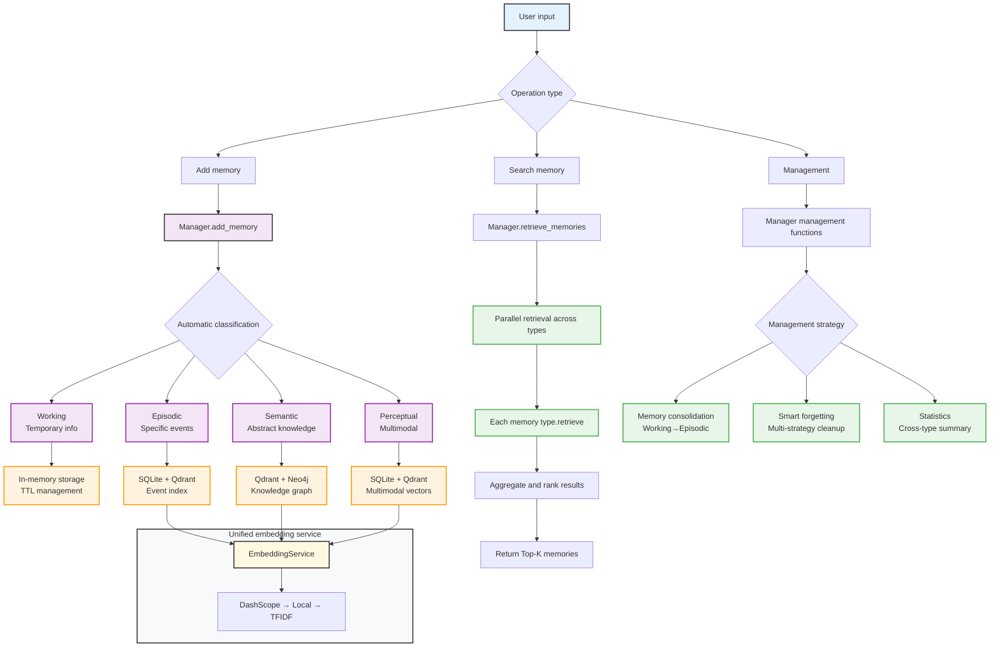
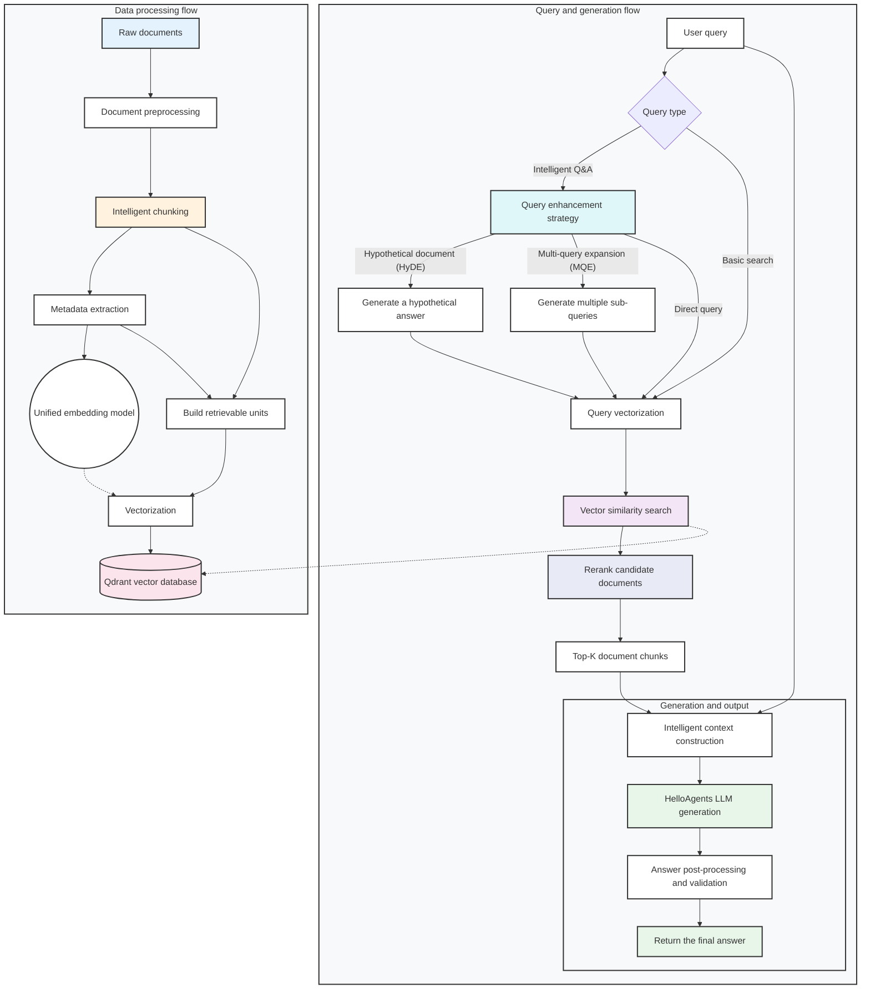
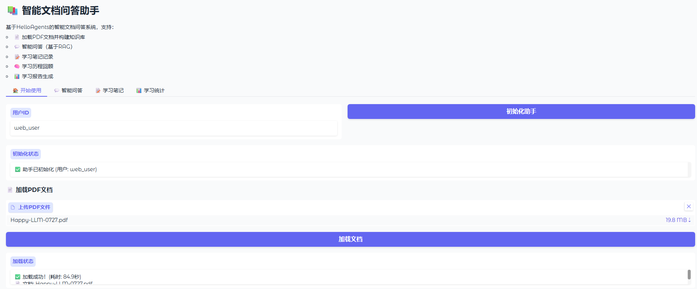
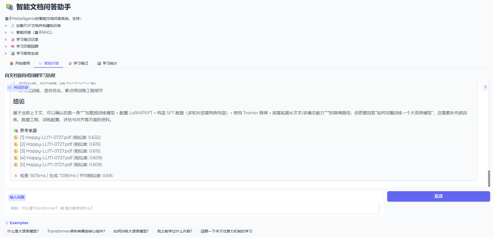
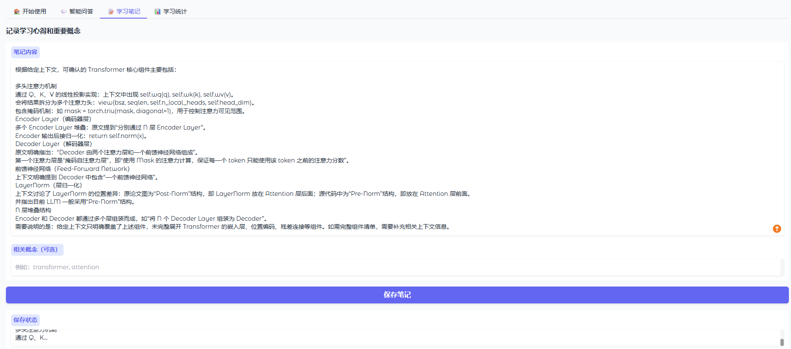
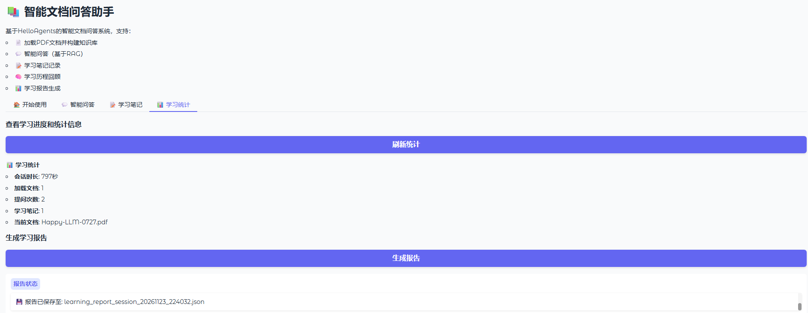

# Hello Agents Advanced Study Log - Task3

Course: [Hello Agents](https://github.com/datawhalechina/Hello-Agents)

## Tasks

- Chapter 8
- End-of-chapter exercises

## Notes - Chapter 8 Memory and Retrieval

### From cognitive science to agent memory

Chapter 7 only lets the agent remember the user's context within a single session, and everything is reset when the program runs again

Also, although the input context length of LLMs keeps growing, it still has a limit. Some patterns for dealing with context problems also need memory

Things like Skills can also be seen, at their core, as involving memory

Next, the knowledge built into an LLM is limited and comes entirely from its training data. When it needs to answer with knowledge that only you have, it generally can't

So to make an agent truly smarter and run more completely, it also needs a memory system

The four-layer structure of the HelloAgents memory system:
```
HelloAgents Memory System
├── Infrastructure Layer
│   ├── MemoryManager - Memory manager (unified scheduling and coordination)
│   ├── MemoryItem - Memory data structure (standardized memory items)
│   ├── MemoryConfig - Configuration management (system parameter settings)
│   └── BaseMemory - Memory base class (common interface definition)
├── Memory Types Layer
│   ├── WorkingMemory - Working memory (temporary information, TTL management)
│   ├── EpisodicMemory - Episodic memory (specific events, time series)
│   ├── SemanticMemory - Semantic memory (abstract knowledge, graph relationships)
│   └── PerceptualMemory - Perceptual memory (multimodal data)
├── Storage Backend Layer
│   ├── QdrantVectorStore - Vector storage (high-performance semantic retrieval)
│   ├── Neo4jGraphStore - Graph storage (knowledge graph management)
│   └── SQLiteDocumentStore - Document storage (structured persistence)
└── Embedding Service Layer
    ├── DashScopeEmbedding - Tongyi Qianwen embedding (cloud API)
    ├── LocalTransformerEmbedding - Local embedding (offline deployment)
    └── TFIDFEmbedding - TFIDF embedding (lightweight fallback)
```

The HelloAgents RAG system
```
HelloAgents RAG System
├── Document Processing Layer
│   ├── DocumentProcessor - Document processor (multi-format parsing)
│   ├── Document - Document object (metadata management)
│   └── Pipeline - RAG pipeline (end-to-end processing)
├── Embedding Layer
│   └── Unified Embedding Interface - Reuses memory system's embedding service
├── Vector Storage Layer
│   └── QdrantVectorStore - Vector database (namespace isolation)
└── Intelligent Q&A Layer
    ├── Multi-strategy Retrieval - Vector retrieval + MQE + HyDE
    ├── Context Construction - Intelligent fragment merging and truncation
    └── LLM-Enhanced Generation - Accurate Q&A based on context
```

### Memory system: giving agents memory

According to cognitive science research, human memory forms through the following stages:

- Encoding: converting perceived information into a storable form
- Storage: saving the encoded information in the memory system
- Retrieval: extracting relevant information from memory as needed
- Consolidation: converting short-term memory into long-term memory
- Forgetting: deleting unimportant or outdated information

The HelloAgents memory system


The operations fall into adding, searching, and managing

When adding memories, the system combines databases and in-process memory for storage
- SQLite: relational database, handles exact searches by condition
- Qdrant: vector database, handles semantic search
- Neo4j: graph database, handles knowledge graph search
- TTL management: short for Time To Live, the lifetime of a piece of data, used together with in-process memory to store temporary information

About abstract knowledge:

As I understand it, a knowledge graph is most useful in situations like these
- Extracting related knowledge from a large amount of scattered data
- Knowledge with many levels (retrieval takes multiple steps)

If it's extracted from conversations alone, I feel it needs long-term accumulation and has to be updated as the user's situation changes

#### Adding memories

1. Get the current session ID
2. If it's multimodal information and a file path is given
   1. If a file type is passed, use it directly
   2. If not, infer the file type from the file path
3. Add the session ID and timestamp to `metadata`
4. Create the memory and add it, with the following parameters
   1. Content
   2. Memory type
   3. Importance (used later for management decisions. It can be specified, or it may use a default value or be calculated by rules)
   4. `metadata`
   5. `auto_classify`: whether to classify automatically, `True` by default

#### Searching memories

Returns a preview of memories with their memory type and importance, and can filter out unimportant memories by importance

#### Managing memories

**Forgetting**

- Importance-based (delete unimportant memories)
- Time-based (delete outdated memories)
- Capacity-based (delete the least important memories when storage is close to its limit)

**Consolidation**

By default, Working memories with importance above 0.7 are converted into Episodic memories

The importance threshold can also be customized

#### Four memory types

##### Working memory (WorkingMemory)

Stores temporary information in the current conversation session, with fast access and automatic cleanup (TTL)

When searching, the relevance score is TF-IDF term-weight similarity × 0.7 + keyword match × 0.3

The relevance score then decays over time (the older, the lower)

Then the weight is calculated as (0.8 + importance × 0.4)

The final formula is `(relevance × time decay) × (0.8 + importance × 0.4)`

> TF-IDF term-weight similarity:
> - TF (term frequency): how many times a word appears in this text. The more often it appears, the higher its weight.
> - IDF (inverse document frequency): the more texts a word appears in, the lower its weight. Words like "user" and "like" appear everywhere and hardly help tell texts apart. A word like "coffee" that appears in only a few texts gets a high weight.
> - TF × IDF: multiplying the two gives each word's weight in this text

##### Episodic memory (EpisodicMemory)

A kind of long-term memory that is not cleaned up automatically. It uses hybrid storage with SQLite + Qdrant and supports vector queries

Query results are sorted by score in descending order, with the scoring formula `(vector similarity × 0.8 + temporal recency × 0.2) × (0.8 + importance × 0.4)`

##### Semantic memory (SemanticMemory)

Uses a hybrid architecture of the Neo4j graph database and the Qdrant vector database

When storing, the content is first vectorized with the embedding model. Then entities and relationships are extracted and stored in the Neo4j graph database, and the vectors, entities, and relationships are stored in the Qdrant vector database

Search ranks results with a mix of vector search and graph search, using the formula `(vector similarity × 0.7 + graph similarity × 0.3) × (0.8 + importance × 0.4)`. When vector search or graph search doesn't return a memory, the corresponding score is 0

##### Perceptual memory (PerceptualMemory)

Supports storing and retrieving data in multiple modalities such as text, images, and audio. It stores each modality separately, which avoids dimension mismatches

Retrieval supports both same-modality and cross-modality modes. Same-modality retrieval uses specialized encoders for exact matching, while cross-modality retrieval needs a more complex semantic alignment mechanism

Scoring formula `(vector similarity × 0.8 + temporal recency × 0.2) × (0.8 + importance × 0.4)`

### RAG system: knowledge retrieval enhancement

Retrieval-augmented generation uses vector search to find relevant chunks in advance and put them into the prompt, which helps the LLM generate better answers



There are two main parts. One is data processing (using the MarkItDown tool, designed to convert every incoming external knowledge source into Markdown before processing), and the other is retrieval and generation

#### RAG system architecture design

```
User Layer: RAGTool unified interface
  ↓
Application Layer: Intelligent Q&A, search, management
  ↓
Processing Layer: Document parsing, chunking, vectorization
  ↓
Storage Layer: Vector database, document storage
  ↓
Foundation Layer: Embedding model, LLM, database
```

##### Multimodal document loading

Uses MarkItDown to convert common document formats to Markdown

Supported formats:
- Documents: PDF, Word, Excel, PowerPoint
- Images: JPG, PNG, GIF (via OCR)
- Audio: MP3, WAV, M4A (via transcription)
- Text: TXT, CSV, JSON, XML, HTML
- Code: Python, JavaScript, Java, etc.

##### Intelligent chunking strategy

Markdown structure-aware chunking flow:

```
Standard Markdown text            Unified format, clear structure
  ↓
Heading hierarchy parsing         #/##/###, hierarchy recognition
  ↓
Paragraph semantic segmentation   Semantic boundaries, integrity guarantee
  ↓
Token-based chunking              Size control, retrieval optimization
  ↓
Overlap strategy optimization     Information continuity, context preservation
  ↓
Vectorization preparation         Embedding vectors, similarity matching
```
To handle different languages, the system also implements a token estimation algorithm for mixed Chinese and English text

##### Unified embedding and vector storage

Converts text into high-dimensional vectors so that computers can understand and compare the semantic similarity of texts

The retrieval ability of a RAG system depends heavily on the quality of the embedding model and the efficiency of the vector storage

##### Advanced retrieval strategies

**Multi-Query Expansion (MQE)**

Improves retrieval recall by generating diverse queries with the same meaning

In other words, the same question is phrased in several ways to widen the matches and improve accuracy, which helps with vague queries

Implemented by asking the LLM to generate several more query keywords

**Hypothetical Document Embeddings (HyDE)**

Set up a target first: assume an answer, then search based on that answer. This solves the gap in the semantic space caused by questions being interrogative sentences while answers are declarative. The sentence style used in the hypothetical answer helps the query to some extent, which is especially useful for queries about technical terms

Implemented by asking the LLM to write a hypothetical answer first

**Extended retrieval framework**

Both enhancement strategies above are exposed for users to choose. Scenarios that need to collect as many candidate documents as possible (high recall) combine them, while performance-sensitive scenarios can use basic retrieval only

It runs the expanded queries first to get a pool of candidate documents, then deduplicates, merges and sorts them by score, and finally returns the top-k

#### Building an intelligent document Q&A assistant

Features:
- Intelligent document processing: PDF -> Markdown, with intelligent chunking, vectorization, and index construction
- Advanced retrieval Q&A: Multi-Query Expansion (MQE) and Hypothetical Document Embeddings (HyDE) improve precision
- Multi-level memory management:
  - Working memory manages the current learning task and context
  - Episodic memory records learning events and query history
  - Semantic memory stores conceptual knowledge and understanding
  - Perceptual memory handles document features and multimodal information
- Personalized learning support: personalized recommendations based on learning history, memory consolidation and selective forgetting, learning report generation and progress tracking


The application is divided into three core parts:

1. Core assistant class (PDFLearningAssistant): wraps the calling logic of RAGTool and MemoryTool
2. Gradio web interface: provides a friendly user interface. You can learn this part from the example code
3. Other core functions: note taking, learning review, statistics, and report generation

##### Core assistant class (PDFLearningAssistant)

**Class initialization**

Initializes
- `user_id`: isolates users
- `session_id`
- Tools
- `stats`: learning statistics, including the session, loaded documents, questions asked, and concepts learned, used to generate the learning report
- The currently loaded document

**Loading a PDF document**

Uses RAGTool for Markdown conversion, chunking, and vectorization

This step is also added to episodic memory, because it provides a record for the learning statistics later

##### Intelligent Q&A

When the user asks a question, the agent first writes the question into working memory (to keep the session record)

Then it uses `rag_tool` to find the answer and adds this query to episodic memory (along with the question)

##### Other core functions

- Note taking: adds a record to semantic memory. A tag can be added with `concept` (but the code doesn't use it), and one learned concept is counted in `stats`
- Learning review: finds related learning records
- Statistics: gets `stats`
- Learning report generation: summarizes the memory contents and generates a report from `stats`

##### Results

Initializing and loading the document



Intelligent Q&A



Learning notes



Learning report



## Exercises

1. This chapter introduced four memory types: working memory, episodic memory, semantic memory, and perceptual memory. Please analyze:

   - In Section 8.2.5, each memory type has a unique scoring formula. Please compare the scoring mechanisms of episodic memory and semantic memory, and explain why episodic memory emphasizes "temporal recency" more (weight 0.2), while semantic memory emphasizes "graph retrieval" more (weight 0.3)?
     - Because the two memories focus on different things. Episodic memory is ordered as a time series, and in the way people think, the newest information is usually a bit more reliable. Semantic memory relies heavily on graph retrieval to begin with and should be good at retrieving knowledge from long ago, so graph retrieval gets a higher weight
   - If you were to design a "personal health management assistant" (needs to record user's diet, exercise, sleep data, and provide health advice), how would you combine these four memory types? Please design specific application scenarios for each memory type.
     - Working memory: for storing the current session's information
     - Episodic memory: for storing the user's diet, exercise, and sleep data
     - Semantic memory: while recording, periodically analyze the user's traits and habits and store them as entities and relationships
     - Perceptual memory: for image information, such as when the user takes a photo of today's meal or a screenshot of their sleep record
   - Working memory uses a TTL (Time To Live) mechanism to automatically clean expired data. Please think: under what circumstances should important working memories be "consolidated" into long-term memory? How to design an automatic consolidation trigger condition?
     - When a memory is about to be stored in episodic memory, search working memory for related conversation and consolidate the memories with high importance and relevance

2. In the RAG system in Section 8.3, we use MarkItDown to uniformly convert various format documents to Markdown. Please think deeply:

   > <strong>Note</strong>: This is a hands-on practice question, actual operation is recommended

   - The current intelligent chunking strategy is based on Markdown heading hierarchy (#, ##, ###) for segmentation. If processing documents without clear heading structure (such as novels, legal provisions), how should the chunking strategy be optimized? Please try to implement a chunking algorithm based on "semantic boundaries".
     - (Unfinished)
   - Section 8.3.5 introduced two advanced retrieval strategies: MQE (Multi-Query Expansion) and HyDE (Hypothetical Document Embeddings). Please select a practical scenario (such as technical document Q&A, medical knowledge retrieval), compare the effect differences of basic retrieval, MQE, and HyDE, and analyze their respective applicable scenarios.
     - (Unfinished)
   - The retrieval quality of the RAG system largely depends on the choice of embedding model. Please compare the three embedding solutions mentioned in this chapter (Bailian API, local Transformer, TF-IDF) from the dimensions of accuracy, speed, cost, offline deployment, etc., and provide selection recommendations.

      | Dimension         | Bailian API (text-embedding-v3)    | Local Transformer (all-MiniLM-L6-v2)                    | TF-IDF                                                                  |
      | ----------------- | ---------------------------------- | ------------------------------------------------------- | ----------------------------------------------------------------------- |
      | Matching          | Dense vectors, matches by meaning  | Dense vectors, matches by meaning                       | Sparse term vectors, matches literal words                              |
      | Runs on           | Cloud                              | Local machine                                           | Local machine                                                           |
      | Chinese accuracy  | High                               | Lower, the model was trained on English data            | Low, a search for 报销 (reimbursement) doesn't find 费用申请 (expense request) |
      | English accuracy  | High                               | Upper-middle                                            | Low, hits only when the keywords match                                  |
      | Input length      | Up to 8,192 tokens per input       | Anything beyond 256 word pieces is truncated            | No limit                                                                |
      | Vector dimensions | 1,024 by default, lower ones available | Fixed at 384                                        | Equal to the vocabulary size, varies with the corpus                    |
      | Speed             | Affected by network latency        | Milliseconds per input on CPU                           | Fastest                                                                 |
      | Cost              | Billed per token                   | No API fees, uses local CPU and memory                  | Almost zero                                                             |
      | Deployment        | Needs only an API key, requires internet | Downloads a ~90 MB model on first run, then works offline | No model needed, works offline                                    |
      | Data privacy      | Text is sent to the cloud          | Text stays on the local machine                         | Text stays on the local machine                                         |
      - For learning and prototyping, Bailian is enough. It handles Chinese well and has no hardware requirements
      - If the data must stay private or the usage volume is large, use the local Transformer
      - If PyTorch can't be installed, or you only search for IDs, model numbers, and proper nouns, use TF-IDF

3. The "forgetting" mechanism of the memory system is an important design that simulates human cognition. Based on the MemoryTool in Section 8.2.3, please complete the following extended practice:

   > <strong>Note</strong>: This is a hands-on practice question, actual operation is recommended

   - Currently, three forgetting strategies are provided: importance-based, time-based, and capacity-based. Please design and implement an "intelligent forgetting" strategy that comprehensively considers importance, access frequency, time decay, and other factors, using weighted scoring to decide which memories should be forgotten.
     - (Unfinished)
   - In long-running agent systems, the memory database may accumulate a large amount of data. Please design a "memory archiving" mechanism: transfer long-unused but potentially valuable memories to cold storage, and restore them when needed. How should this mechanism be integrated with the existing four memory types?
     - (Unfinished)
   - Think: If the agent needs to "forget" certain sensitive information (such as user privacy data), is it sufficient to just delete it from the database? In the case of using vector databases and graph databases, how to ensure data is completely cleared?
     - (Unfinished)

4. In the "Intelligent Learning Assistant" case in Section 8.4, we combined MemoryTool and RAGTool. Please analyze in depth:

   - The `ask_question()` method in the case uses both RAG retrieval and memory retrieval. Please analyze: under what circumstances should RAG be prioritized? Under what circumstances should Memory be prioritized? How to design an "intelligent routing" mechanism to automatically select the most appropriate retrieval method?
     - Use RAG when the answer to the user's question can be found in the uploaded materials, and memory retrieval when the question relates to past conversations
     - There are roughly a few approaches, and they can be combined
       - Prepare a few sample questions for each of the two retrieval methods and convert them to vectors in advance. The program first computes the vector similarity of the current question and uses a method when the similarity exceeds a threshold. The downside is low accuracy, so it can only make a rough call
       - Let the LLM choose by itself based on the descriptions of the two tools. The downside is higher usage
       - Use a decision model. The downside is having to connect another model
   - The current learning report (`generate_report()`) only contains statistical information. Please extend this function and design a more intelligent learning report generator: able to analyze user's learning trajectory, identify knowledge blind spots, and recommend next learning content. Which memory types and retrieval strategies are needed for this?
     - Learning trajectory: episodic memory and semantic memory. Extract what the user learned along with the timestamps. Multi-query expansion can help recognize the different ways the user refers to the same knowledge point
     - Knowledge blind spots: use semantic memory and the document chunks. Find the knowledge points covered in the chunks but missing from semantic memory, using vector similarity (everything minus what's already there)
     - Recommending what to learn next: take the knowledge points from the newest records in the learning trajectory and check which blind spots fall under the same parent chunk, or use HyDE to produce a hypothetical result and check whether the knowledge documents contain it
   - Suppose you want to deploy this learning assistant as a multi-user Web service, where each user has independent memory and knowledge base. Please design a data isolation solution: how to implement user-level data isolation in Qdrant and Neo4j? How to optimize retrieval performance in multi-user scenarios?
     - Qdrant: write the user ID into each point's payload, and isolate users with a filter at query time
     - Neo4j: split namespaces by user ID, tag every node with the user ID, and include the user ID in the starting point of each query
     - When creating the payload index in Qdrant, set `is_tenant=True`. This stores each tenant's points together on disk, which makes searches more efficient. Use the advanced retrieval strategies sparingly, because they call the LLM and are not great for either efficiency or cost

5. Semantic memory uses Neo4j graph database to store knowledge graphs. Please think:

   - In the semantic memory implementation in Section 8.2.5, the system automatically extracts entities and relationships to build knowledge graphs. Please analyze: how accurate is this automatic extraction? Under what circumstances might incorrect entities or relationships be extracted? How to design a "knowledge graph quality assessment" mechanism?
     - Most of the entities spaCy recognizes differ from the ones you'd actually want from technical concepts. The relationships are too simple. They only record that something was mentioned, with no semantic relationships such as supports or opposes
     - When the meaning is ambiguous
     - Check whether the extracted relationships are meaningful. If they're all CO_OCCURS, they mean nothing. Check whether nodes are semantically similar (similar vectors) or differ only in letter case. If so, there are a lot of useless nodes
   - An important advantage of knowledge graphs is supporting complex relational reasoning. Please design a query scenario that fully utilizes Neo4j's graph query capabilities (such as multi-hop relationships, path finding) to accomplish tasks that pure vector retrieval cannot complete.
     - In a meeting that discusses several issues, find which issues the current speaker's final conclusion can solve. For example, product A's promotion isn't working well, its sales are poor, and people say it has many bugs. If one of the final conclusions is to revise the user manual, semantic similarity might put it under fixing bugs. But if `user manual-(lowers)->onboarding difficulty-(improves)->promotion` is extracted, it can be classified correctly
   - Compare the "vector retrieval + graph retrieval" hybrid strategy of semantic memory with pure vector retrieval: in what types of queries can graph retrieval bring significant performance improvements? Please illustrate with specific examples.
     - The previous answer pretty much covers this
