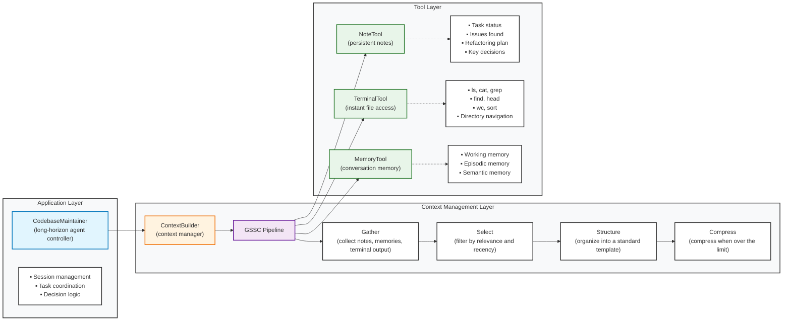

# Hello Agents Advanced Study Log - Task4

Course: [Hello Agents](https://github.com/datawhalechina/Hello-Agents)

## Tasks

- Chapter 9
- End-of-chapter exercises

## Notes - Chapter 9 Context Engineering

### Why context engineering matters

An LLM's context is limited. The longer the context, the more its attention gets spread out and the worse the model performs. This is context rot

The tools in earlier chapters need the LLM to choose them by name and description, and memories also have to be given to the LLM in the prompt so that the model can refer to them

So the longer the agent runs, the more there is to put in the prompt. Without context management, the background alone may fill the context, or the LLM's ability drops because it has too much to process

#### The "anatomy" of effective context

The goal of good context engineering: maximize the probability of getting the expected result with as few tokens as possible, but with high signal density

- System prompt: clear and straightforward, the "minimum necessary information set" that fully outlines the expected behavior
- Tools:
  - Single responsibility, low overlap with each other, clear interface semantics
  - Robust to errors
  - Clear and unambiguous parameter descriptions that make full use of the model's strengths in expression and reasoning
- Few-shot examples: carefully select a set of diverse and typical examples that directly portray the "expected behavior" (my own suggestion is to avoid biased examples. For example, when the task is to judge right or wrong, include both examples where the answer is right and examples where it's wrong)

#### Context retrieval and agentic search

Engineering practice is gradually moving from "one-time retrieval before inference (embedding retrieval)" to "Just-in-time (JIT) context"

> The metadata of references itself can help refine behavior: directory hierarchy, naming conventions, timestamps, etc., all implicitly convey "purpose and timeliness". For example, tests/test_utils.py and src/core/test_utils.py have different semantic implications.

In other words, keep the paths to look things up, and call tools to read them when needed, using progressive disclosure

But this requires designing the tools, directories, and names so that they guide the model. Each extra layer of disclosure also means the model needs one more step of thinking and spends one more step's worth of tokens and time. And once it picks the wrong thing, the later results may go wrong or the work is wasted

That's why TokenEconomizer, recently released by Microsoft, includes intervention when an agent keeps failing (when it judges that the agent is stuck, it suggests a different approach), to reduce token consumption

#### Context engineering for long-horizon tasks

- Compaction: summarize the context. Important information may be lost, so first optimize recall to avoid omissions, then improve precision
- Structured note-taking: also called "agent memory". Write information into files that are kept long term, and search them as needed
- Sub-agent architectures: assign tasks to sub-agents with isolated contexts, leave out the intermediate process, and return only the result to the main agent. This increases token consumption, so it's best to evaluate whether the current task is worth a sub-agent before starting one

### Practice in Hello-Agents: ContextBuilder

- Unified entry: abstract "Gather-Select-Structure-Compress" into a reusable GSSC pipeline
- Stable form: output a context template with a fixed skeleton, facilitating debugging, A/B testing, and evaluation
  - `[Role & Policies]`: Clarify the Agent's role positioning and behavioral guidelines
  - `[Task]`: The specific task currently to be completed
  - `[State]`: The Agent's current state and context information
  - `[Evidence]`: Evidence information retrieved from external knowledge bases
  - `[Context]`: Historical dialogue and related memories
  - `[Output]`: Expected output format and requirements
- Budget guardian: retain high-value information as much as possible within the token budget, providing fallback compression strategies for over-limit contexts
- Minimum rules: do not introduce classification dimensions such as source/priority, to avoid complexity growth

#### Core data structures

**ContextPacket: candidate information packet**

- `content`: Information content
- `timestamp`: Timestamp
- `token_count`: Token count
- `relevance_score`: Relevance score (0.0-1.0)
- `metadata`: Optional metadata

**ContextConfig: configuration management**

- `max_tokens`: Maximum token count
- `reserve_ratio`: Ratio reserved for system instructions (0.0-1.0)
- `min_relevance`: Minimum relevance threshold
- `enable_compression`: Whether to enable compression
- `recency_weight`: Recency weight (0.0-1.0)
- `relevance_weight`: Relevance weight (0.0-1.0)

#### GSSC pipeline in detail

**Gather: multi-source information collection**

- Add the system instructions to a ContextPacket (always kept, distinguished by `type` in `metadata`)
- Retrieve memories related to the current conversation and store them in ContextPackets
- Retrieve related knowledge from RAG and store it in ContextPackets
- Add the recent conversation history (the default window size is 5)
- You can also add anything else you need into ContextPackets

Each addition is wrapped in try-except, so one failure doesn't affect the others

**Select: intelligent information selection**

Scores and selects candidate information based on relevance and recency

- Separate the system instructions and count their tokens on their own
- Calculate a combined score for the rest of the information
  - Relevance: can be replaced with vector similarity in production
  - Recency: uses an exponential decay model that keeps the score high within 24 hours and then decays gradually
  - Combined score = relevance weight × relevance + recency weight × recency
  - Filter out information below the minimum relevance threshold
  - Sort in descending order
- Greedy selection: fill from the highest score down until the token limit is reached

**Structure: structured output**

Distinguished by `type` in `metadata`

- `[Role & Policies]`: Clarify the Agent's role positioning and behavioral guidelines
- `[Task]`: The specific task currently to be completed
- `[State]`: The Agent's current state and context information
- `[Evidence]`: Evidence information retrieved from external knowledge bases
- `[Context]`: Historical dialogue and related memories
- `[Output]`: Expected output format and requirements

**Compress: fallback compression**

LLM summarization can be used, but divide the context into sections in advance and compress each section separately to keep the structure intact. This preserves the completeness of the information to some extent

#### Best practices

- Dynamically adjust the token budget: use a smaller budget for simple tasks and a larger budget for complex tasks
- Relevance calculation optimization: replace simple keyword overlap with vector similarity calculation to improve retrieval quality
- Caching mechanism: for unchanging system instructions and knowledge base content, implement caching to avoid repeated calculations
- Monitoring and logging: record statistics for each context build for later optimization
- A/B testing: find the optimal configuration of key parameters through A/B testing

### NoteTool: structured notes

- Structured recording: uses Markdown + YAML format, suitable for both machine parsing and human reading and editing
- Version friendly: plain text format, naturally supports version control systems like Git
- Low overhead: no complex database operations required, suitable for lightweight state tracking
- Flexible categorization: flexibly organize notes through type and tags, supporting multi-dimensional retrieval

Use cases:
- Progress and metrics need to be recorded over a long period
- Reports or notes need to be produced
- Working with ContextBuilder as one form of long-term memory

#### Storage format in detail

- Note file format: Markdown
- Index file: a `notes_index.json` file is maintained as the table of contents for the notes

#### Core operations in detail

**create: create a note**

1. Generate an ID: a file name with a timestamp
2. Build `metadata`: `id`, `title`, `type`, `tags`, `created_at`, `updated_at`
3. Build the Markdown file content and save it
4. Update the index

**read: read a note**

Read and parse the note, separating the YAML from the body

**update: update a note**

Update the title, content, type, and tags (the timestamp and the index are updated by default)

**search: search notes**

Can filter by type and tags

**list: list notes**

List the notes using the index file

**summary: note summary**

Count the total number of notes and the number of notes of each type, and list the 5 most recently updated notes

**delete: delete a note**

Delete the note file and its entry in the index

#### Best practices

1. Reasonable note classification:
   - `task_state`: Record phased progress and status
   - `conclusion`: Record important conclusions and findings
   - `blocker`: Record blocking issues, highest priority
   - `action`: Record next action plans
   - `reference`: Record important reference materials
2. Regular cleanup and archiving:
   - For resolved blockers, update to conclusion
   - For outdated actions, delete or update promptly
   - Use tags for version management, such as `["v1.0", "completed"]`
3. Cooperation with ContextBuilder:
   - Retrieve relevant notes before each round of dialogue
   - Set different relevance scores based on note type (blocker > action > conclusion)
   - Limit the number of notes to avoid context overload
4. Human-machine collaboration:
   - Notes are in human-readable Markdown format, supporting manual editing
   - Use Git for version control to track note evolution
   - At key stages, manually review notes generated by the Agent
5. Automated workflow:
   - Regularly generate note summary reports
   - Automatically generate project progress documents based on notes
   - Synchronize note content to other systems (such as Notion, Confluence)

### TerminalTool: instant file system access

Lets the agent access files on the computer by running command-line commands

Pros: enables the just-in-time context and progressive disclosure mentioned earlier

Cons: serious security risks. Files on the computer are exposed to the risk of being deleted by mistake at any time, and confidential files may be accessed

Security mechanisms
- Command whitelist: only safe read-only commands are allowed, and any operation that might modify the system is completely forbidden
  ```python
  ALLOWED_COMMANDS = {
      # File listing and information
      'ls', 'dir', 'tree',
      # File content viewing
      'cat', 'head', 'tail', 'less', 'more',
      # File search
      'find', 'grep', 'egrep', 'fgrep',
      # Text processing
      'wc', 'sort', 'uniq', 'cut', 'awk', 'sed',
      # Directory operations
      'pwd', 'cd',
      # File information
      'file', 'stat', 'du', 'df',
      # Others
      'echo', 'which', 'whereis',
  }
  ```
- Working directory restriction (sandbox)
- Timeout control to prevent unlimited resource use
- Output size limit: limits the size of command output to prevent memory overflow

#### Core functions in detail

**Command execution**

Runs the command with `subprocess.run`. If the result contains errors, they are appended to the returned output too
```python
def _execute_command(self, command: str) -> str:
    """Execute command"""
    try:
        # Execute command in current directory
        result = subprocess.run(
            command,
            shell=True,
            cwd=str(self.current_dir),  # Execute in current working directory (sandbox)
            capture_output=True,
            text=True,
            timeout=self.timeout,       # Timeout control
            env=os.environ.copy()
        )

        # Merge standard output and standard error
        output = result.stdout
        if result.stderr:
            output += f"\n[stderr]\n{result.stderr}"

        # Check output size (output size limit)
        if len(output) > self.max_output_size:
            output = output[:self.max_output_size]
            output += f"\n\n⚠️ Output truncated (exceeded {self.max_output_size} bytes)"

        # Add return code information
        if result.returncode != 0:
            output = f"⚠️ Command return code: {result.returncode}\n\n{output}"

        return output if output else "✅ Command executed successfully (no output)"

    except subprocess.TimeoutExpired:
        return f"❌ Command execution timeout (exceeded {self.timeout} seconds)"
    except Exception as e:
        return f"❌ Command execution failed: {e}"
```

**Directory navigation**

Special handling of the cd command lets the agent move into different directories in the file system
- Resolve relative paths
- Check whether the resolved path leaves the working directory (if it does, return an error message)
- Check whether the directory exists
- Update `self.current_dir` to the new path

#### Typical usage patterns

- Exploratory navigation
  1. View the project root directory
  2. View the source directory structure
  3. Search for specific patterns (grep)
- Data file analysis: quickly understand the structure and content of data files (can count and view CSV files)
- Log file analysis: search by date, count error types, and so on
- Codebase analysis: assists code review and understanding

#### Working with other tools

- MemoryTool: information found by TerminalTool can be stored in the memory system
- NoteTool: important findings can be recorded as structured notes
- ContextBuilder: TerminalTool output can be part of the context

### Long-horizon agent in practice: codebase maintenance assistant



Integrates ContextBuilder + NoteTool + TerminalTool + MemoryTool to manage codebase maintenance tasks across sessions
1. Load background information according to the run mode
   - `auto`: decides automatically whether to use tools, using the same logic as `explore`
   - `explore`: focuses on code exploration and gives the LLM the code structure
   - `analyze`: focuses on issue analysis and gives the LLM the code statistics and the TODO and FIXME marks in the code
   - `plan`: focuses on task planning and gives the LLM the titles of the 3 latest task status notes (`task_state`)
2. Search related notes and set different relevance scores by note type
3. Build an optimized context, choosing different system instructions by run mode
   - `auto`: asks the system to decide automatically and choose tools
   - `explore`: asks the system to focus on code exploration, actively learn the code structure, and record it
   - `analyze`: asks the system to focus on issue analysis, find the TODOs and FIXMEs in the code, assess code quality, and record it
   - `plan`: asks the system to focus on task planning, review past notes, make the next plan, and update the status
4. Call the LLM
5. Post-processing
   - Mechanically detects words such as `"问题", "bug", "错误", "阻塞"` (problem, bug, error, blocked) in the LLM's reply and creates an issue note (`blocker`)
   - If none of those words are found, mechanically detects words such as `"计划", "下一步", "任务", "todo"` (plan, next step, task, todo) in the user input and creates a task plan note (`action`)
6. Update the conversation history

## Exercises

1. This chapter introduced the difference between context engineering and prompt engineering. Please analyze:

   - Section 9.1 mentioned "context must be viewed as a limited resource with diminishing marginal returns". Please explain what the "context rot" phenomenon is? Why do we still need to carefully manage context even when models support 100K or even 200K context windows?
     - Because no matter how large the LLM's context window is, stuffing too much into the context at once dilutes the model's attention and lowers its ability. Not to mention cases where the context quality is poor, which strongly affects the model's output.
   - Suppose you want to build a "code review assistant" that needs to analyze a codebase containing 50 files. Please compare two strategies: (1) Load all file content into context at once; (2) Use JIT (Just-in-time) context, retrieving files on demand through tools. Analyze the advantages, disadvantages, and applicable scenarios of each.
     - The first
       - Pros: no need to call tools back and forth to read files, so it's more efficient
       - Cons: too many files lead to context rot
     - The second
       - Pros: progressive disclosure keeps the context within a controllable range
       - Cons: tools have to be called back and forth to read files, and if the wrong file is found, the search starts over, which increases consumption
   - Section 9.2.1 mentioned two extreme pitfalls of system prompts: "over-hardcoding" and "too vague". Please give a practical example of each and explain how to find the right balance.
     - Over-hardcoding: when explaining code
         ```
         If the question contains "what does it do" or "what does it mean", find the corresponding function and explain it line by line.
         If the question contains "where" or "which file", run grep -rn "<name>" . and return the result as is.
         If the question contains "call flow" or "how is it called", start from the main function and list the functions in call order.
         If the question contains "why", answer "This design decouples the components, making them easier to extend and maintain."
         If the question contains "throws an error" or "Error", reply "Please paste the full error message."
         If the question contains "how to run", reply "Run pip install -r requirements.txt first, then run python main.py."
         If none of the above apply, reply "Please tell me which function you want to know about."
         ```
       In this case, if it's a Java project, the model won't know what to do
     - Too vague: when explaining code
       ```
       You are a code expert. Answer the user's questions in a way that is easy to understand
       ```
     - Balance:
       - Write rules, but not specific trigger words
       - Write down information the model can't possibly know on its own
       - For files, give only the paths and let the agent look them up itself
       - Tell the model the background, the problem, how to look things up, and the requirements

2. The GSSC (Gather-Select-Structure-Compress) pipeline is the core technology of this chapter. Please think deeply:

   > <strong>Note</strong>: This is a hands-on practice question, actual operation is recommended

   - In the ContextBuilder implementation in Section 9.3, the four stages each have different responsibilities. Please analyze: If a certain stage fails (such as the Select stage selecting irrelevant information, or the Compress stage over-compressing leading to information loss), what impact will it have on the final agent performance?
     - Gather: if the collected context misses important information, the final output looks as if it forgot the user's earlier requests
     - Select: if irrelevant information is selected, it causes context rot and lowers the output quality
     - Structure: without structured information, a strong model probably won't be affected much and will spend some extra time and tokens organizing the information while thinking, but a weaker model's output quality will be directly affected
     - Compress: if over-compression loses information, the model can't answer questions related to the lost information
   - Based on the code in Section 9.3.4, add a "context quality assessment" function to ContextBuilder: After each context build, automatically evaluate the information density, relevance, and completeness of the context, and provide optimization suggestions.
     - (Unfinished)
   - The "compression" stage in the GSSC pipeline uses LLM for intelligent summarization. Please think: Under what circumstances might simple truncation or sliding window strategies be more appropriate than LLM summarization? Design a hybrid compression strategy that combines the advantages of multiple compression methods.
     - When simple truncation fits:
       - Tool calls make up most of the context and their results can be obtained again. For example, if the context is all command-line tools reading files, keeping only the commands frees up the context
       - The questions are unrelated to each other, or related only to the last few rounds of conversation (but this is hard to judge)
       - Summarization errors are costly, for example when the content includes error messages or important decisions
     - Hybrid compression strategy:
       - Replace the returned tool results with reproducible tool commands
       - If the questions are unrelated, let the LLM hand the task to a sub-agent with a fresh context and return only the result
       - Save important results as files and record their paths. Keep these file paths unchanged when the context is full

3. NoteTool and TerminalTool are key tools supporting long-horizon tasks. Based on Sections 9.4 and 9.5, please complete the following extension practices:

   > <strong>Note</strong>: This is a hands-on practice question, actual operation is recommended

   - NoteTool uses a hierarchical note system (project notes, task notes, temporary notes). Please design an "automatic note organization" mechanism: When temporary notes accumulate to a certain number, the agent can automatically analyze these notes, promote important information to task notes or project notes, and clean up redundant content.
     - (Unfinished)
   - TerminalTool provides file system operation capabilities, but Section 9.5.2 emphasizes security design. Please analyze: Are the current security mechanisms (path validation, command whitelist, permission check) sufficient? If the agent needs to access sensitive files or execute dangerous operations, how should a "human-machine collaborative approval" process be designed?
     - (Unfinished)
   - Combining NoteTool and TerminalTool, design an "intelligent code refactoring assistant": Can analyze codebase structure, record refactoring plans, execute refactoring operations step by step, and track progress and encountered problems in notes. Please draw a complete workflow diagram.
     - (Unfinished)

4. In the "long-horizon task management" case in Section 9.6, we saw the value of context engineering in practical applications. Please analyze in depth:

   - The case uses a "layered context management" strategy: instant access (TerminalTool) + session memory (MemoryTool) + persistent notes (NoteTool). Please analyze: How should these three layers coordinate? What information should be placed in which layer? How to avoid information redundancy and inconsistency?
     - Tools run through instant access are recorded in working memory. For things that need to go into persistent notes, add an entry to semantic memory, but store the note's path in it
     - To avoid redundancy and inconsistency, each piece of information should have only one original copy, and other places store a path pointing to it. If something already in memory gets written into a note, replace the memory entry with the note's path
   - Suppose an interruption occurs during task execution (such as system crash, network disconnection), the agent needs to recover state from notes and continue execution. Please design a "resume from breakpoint" mechanism: How to record sufficient state information in notes? How to verify that the recovered state is correct?
     - Add a status tag to every task and maintain bak files, one for each running task. The program overwrites the bak after every tool call and at the end of every round. After an interruption, load the bak file. When the bak is usable, append its messages to the context and add the records in working memory back into Memory one by one
     - How to verify that the recovered state is correct
       - Compare the working memory records in the bak with the recovered working memory, checking the count and the content
       - Check the latest instant file access command, and see whether running it gives the same result as the one in the bak
       - Check whether the status tag matches the status recorded in the bak
   - Long-horizon tasks often involve parallel or serial execution of multiple subtasks. Please design a "task dependency management" system: Can express dependency relationships between tasks (such as "Task B must be executed after Task A is completed"), and automatically schedule task execution order. How should this system integrate with NoteTool?
     - Add an execution status tag and a prerequisite tag to each task in the plan note. If the task about to run has prerequisites, check their execution status tags. If one shows in progress or not started, don't run the current task. Instead keep checking whether that task has prerequisites, until reaching the first unfinished prerequisite, and start executing in order from there

5. This chapter repeatedly mentioned the concept of "progressive disclosure". Please think:

   - In Section 9.2.2, progressive disclosure is described as "each interaction step produces new context, which in turn guides the next decision". Please design a specific application scenario (such as academic paper writing, complex problem debugging), demonstrating how progressive disclosure helps agents complete tasks more efficiently.
     - In academic paper writing, the references go in the `reference` folder and are named after the paper titles, the experiment materials go in the `experiment` folder, and the system materials go in the `system` folder.

       When writing the paper, the agent doesn't need to keep the content of every file in the context. It only needs to know the path of each folder. Even without the folder paths, if the folders and files are named well, it can roughly guess what each folder contains when it first scans the directory.

       When the LLM decides during its thinking to look for a certain kind of file, it then uses a tool to read the file at the corresponding path. This saves context space for more important things and prevents context rot
   - A potential risk of progressive disclosure is "inefficient exploration": The agent may waste time on unimportant details or miss key information. Please design an "exploration guidance" mechanism: Through heuristic rules or metacognitive strategies, help the agent make smarter decisions about "what to explore next".
     - After a certain number of tool calls, require the agent to switch to a more specific query
     - After getting each step's result, compare it with the original task and the progress or plan, and consider whether to change the steps
     - Maintain a file that maps questions to the file paths finally found, so that a similar question later can go straight to the path
   - Compare "progressive disclosure" with traditional "load all context at once": In what types of tasks does the former have obvious advantages? In what types of tasks might the latter be more appropriate? Please provide at least 3 examples of different types of tasks.
     - Progressive disclosure: tasks where things are stored in clear locations and there is a lot to read. For example:
       - A code analysis agent analyzing the entire codebase
       - A paper writing agent checking the text against the references
       - A research agent searching for resources to write an innovation analysis report
     - Loading all context at once: when not much reference material is needed, or when the full text has to be read. For example:
       - Asking the agent to speak in a certain tone
       - Asking the agent to check whether a generated reply follows five rules
       - Asking the agent to translate or polish a short article of a few thousand words
