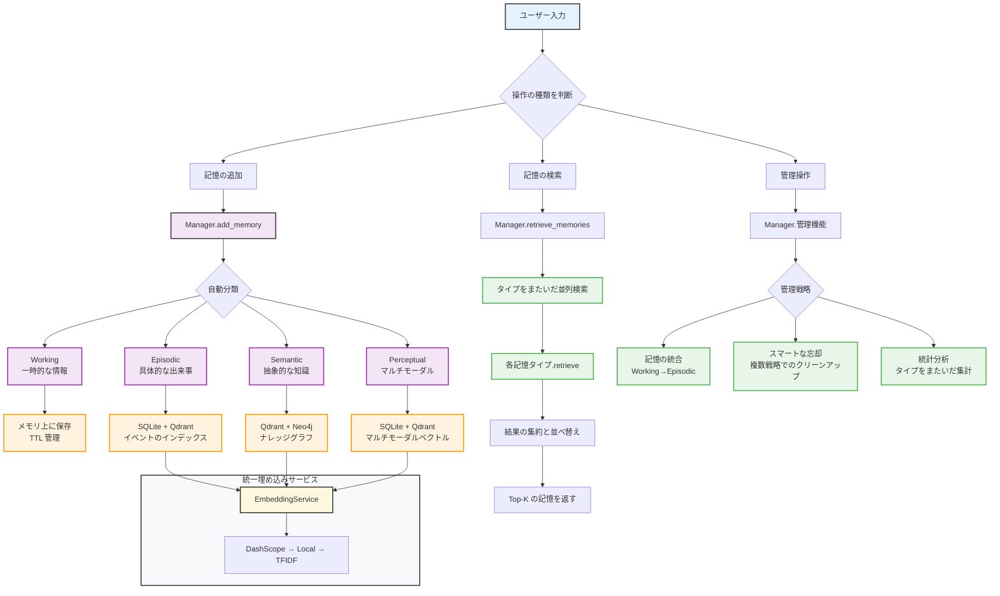
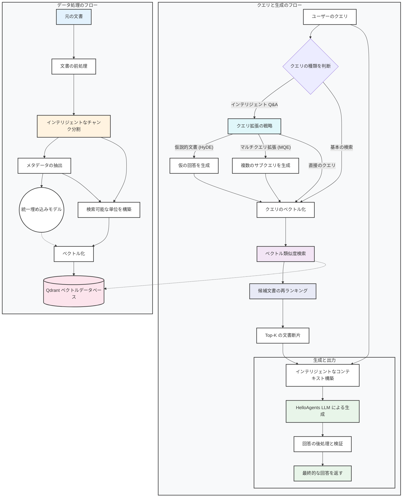
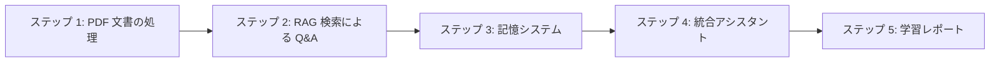
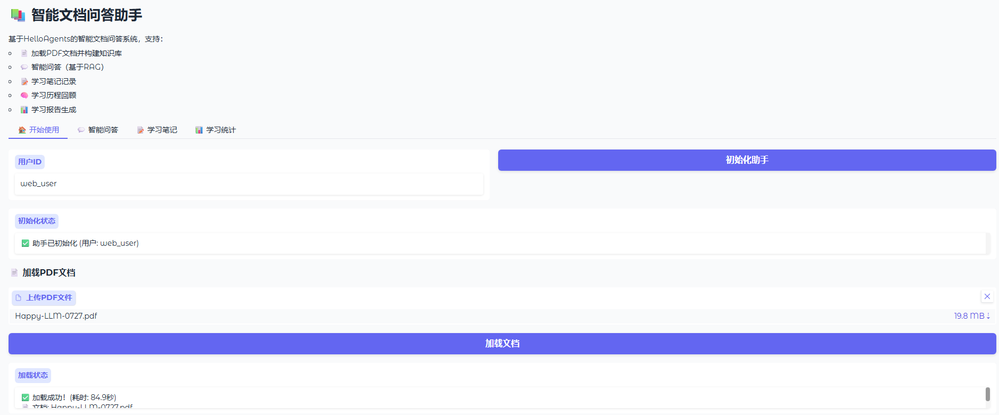
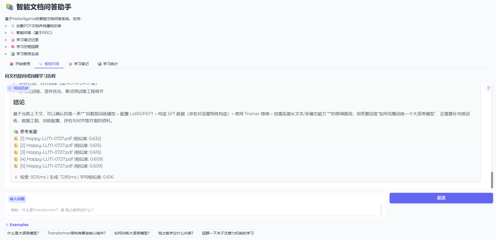
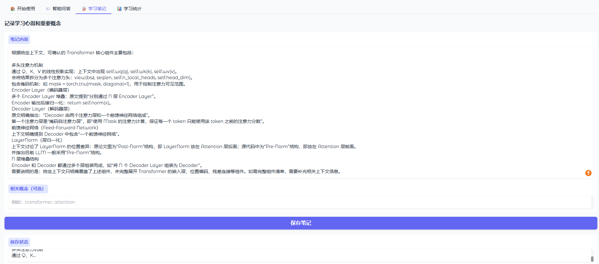
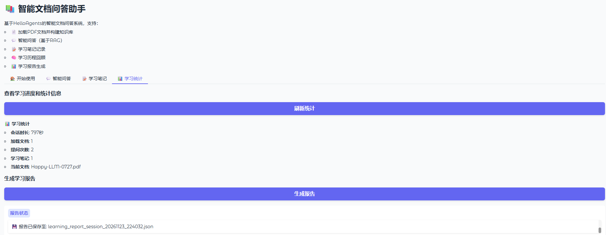

# Hello Agents 応用編 学習記録 - Task3

コース: [Hello Agents](https://github.com/datawhalechina/Hello-Agents)

## タスク

- 第 8 章
- 章末の練習問題

## ノート - 第 8 章 記憶と検索

### 認知科学からエージェントの記憶へ

第 7 章では、agent が同じセッション内のユーザーのコンテキストを覚えられるようになっただけで、プログラムを再実行するとすべてリセットされる

また、LLM の入力コンテキスト長は伸び続けているが、それでも上限はある。コンテキストの問題に対応するパターンの中には、記憶が必要になるものもある

ほかに Skill のようなものも、本質的には記憶が関わっていると見なせる

次に、LLM に組み込まれた知識には限界があり、すべて学習データから来ている。独自の知識で答える必要があるとき、ふつうは答えられない

そのため、agent を本当に賢くし、より完全に動かすには、記憶システムも必要になる

HelloAgents の記憶システムの 4 層構造:
```
HelloAgents 記憶システム
├── インフラ層 (Infrastructure Layer)
│   ├── MemoryManager - 記憶マネージャー（統一的なスケジューリングと調整）
│   ├── MemoryItem - 記憶のデータ構造（標準化された記憶項目）
│   ├── MemoryConfig - 設定管理（システムパラメータの設定）
│   └── BaseMemory - 記憶の基底クラス（共通インターフェースの定義）
├── 記憶タイプ層 (Memory Types Layer)
│   ├── WorkingMemory - ワーキングメモリ（一時的な情報、TTL 管理）
│   ├── EpisodicMemory - エピソード記憶（具体的な出来事、時系列）
│   ├── SemanticMemory - 意味記憶（抽象的な知識、グラフの関係）
│   └── PerceptualMemory - 知覚記憶（マルチモーダルデータ）
├── ストレージバックエンド層 (Storage Backend Layer)
│   ├── QdrantVectorStore - ベクトルストレージ（高性能なセマンティック検索）
│   ├── Neo4jGraphStore - グラフストレージ（ナレッジグラフの管理）
│   └── SQLiteDocumentStore - ドキュメントストレージ（構造化された永続化）
└── 埋め込みサービス層 (Embedding Service Layer)
    ├── DashScopeEmbedding - 通義千問の埋め込み（クラウド API）
    ├── LocalTransformerEmbedding - ローカル埋め込み（オフライン環境へのデプロイ）
    └── TFIDFEmbedding - TFIDF 埋め込み（軽量なフォールバック）
```

HelloAgents の RAG システム
```
HelloAgents RAG システム
├── 文書処理層 (Document Processing Layer)
│   ├── DocumentProcessor - 文書プロセッサ（複数形式の解析）
│   ├── Document - 文書オブジェクト（メタデータ管理）
│   └── Pipeline - RAG パイプライン（エンドツーエンドの処理）
├── 埋め込み表現層 (Embedding Layer)
│   └── 統一埋め込みインターフェース - 記憶システムの埋め込みサービスを再利用
├── ベクトルストレージ層 (Vector Storage Layer)
│   └── QdrantVectorStore - ベクトルデータベース（名前空間による分離）
└── インテリジェント Q&A 層 (Intelligent Q&A Layer)
    ├── 複数戦略の検索 - ベクトル検索 + MQE + HyDE
    ├── コンテキスト構築 - 断片のインテリジェントな結合と切り詰め
    └── LLM による拡張生成 - コンテキストにもとづく正確な Q&A
```

### 記憶システム: エージェントに記憶を持たせる

認知科学の研究によると、人間の記憶は次の段階を経て形成される:

- 符号化（Encoding）: 知覚した情報を保存できる形に変換する
- 貯蔵（Storage）: 符号化した情報を記憶システムに保存する
- 検索（Retrieval）: 必要に応じて記憶から関連する情報を取り出す
- 固定化（Consolidation）: 短期記憶を長期記憶に変換する
- 忘却（Forgetting）: 重要でない情報や古くなった情報を削除する

HelloAgents の記憶システム


操作は追加、検索、管理に分かれる

記憶を追加するときは、データベースとメモリを組み合わせて記憶を保存している
- SQLite: リレーショナルデータベース。条件による正確な検索を担当する
- Qdrant: ベクトルデータベース。セマンティック検索を担当する
- Neo4j: グラフデータベース。ナレッジグラフの検索を担当する
- TTL 管理: Time To Live の略で、データ 1 件の生存時間を指す。一時的な情報を保存するときにメモリと組み合わせて使う

抽象的な知識について:

自分の理解では、ナレッジグラフは次のような場面で力を発揮しやすい
- 大量の断片的なデータから関連する知識を抽出する
- 知識の階層が多い（検索のときに複数ステップの検索が必要）

会話だけから抽出する場合は、長期間の蓄積が必要で、ユーザーの状況に合わせて更新する必要もあると感じる

#### 記憶の追加

1. 現在のセッション ID を取得する
2. マルチモーダルな情報で、ファイルパスが指定されている場合
   1. ファイルタイプが渡されていれば、そのまま使う
   2. 渡されていなければ、ファイルパスの情報からファイルタイプを解析する
3. セッション ID とタイムスタンプを `metadata` に追加する
4. 記憶を作成して追加する。次のパラメータを含む
   1. 内容
   2. 記憶タイプ
   3. 重要度（後で管理するときの判断に使う。指定することもでき、デフォルト値やルールによる計算が使われることもある）
   4. `metadata`
   5. `auto_classify`: 自動で分類するかどうか。デフォルトは `True`

#### 記憶の検索

記憶タイプと重要度つきの記憶のプレビューを返す。重要度で重要でない記憶を除外することもできる

#### 記憶の管理

**忘却**

- 重要度にもとづく（重要でない記憶を削除する）
- 時間にもとづく（古くなった記憶を削除する）
- 容量にもとづく（ストレージが上限に近づいたとき、最も重要でない記憶を削除する）

**統合**

デフォルトでは、重要度が 0.7 を超える Working の記憶を Episodic の記憶に変換する

重要度のしきい値はカスタマイズすることもできる

#### 4 種類の記憶

##### ワーキングメモリ（WorkingMemory）

現在の会話セッションの一時的な情報を保存する。すばやくアクセスでき、自動でクリーンアップされる（TTL）

検索するときは、TF-IDF の単語重み類似度 × 0.7 + キーワード一致 × 0.3 で関連度スコアを求める

次に、時間とともに関連度スコアを減衰させる（古いほどスコアが低くなる）

その後、(0.8 + 重要度 × 0.4) で重みを計算する

最終的な式は `(関連度 × 時間減衰) × (0.8 + 重要度 × 0.4)`

> TF-IDF の単語重み類似度:
> - TF（単語の出現頻度）: ある単語がそのテキストに出てくる回数。多く出てくるほど重みが高くなる。
> - IDF（逆文書頻度）: ある単語が多くのテキストに出てくるほど、重みが低くなる。「ユーザー」「好き」のようにどこにでも出てくる単語は、テキストの区別にはほとんど使えない。「コーヒー」のように一部のテキストにしか出てこない単語は重みが高くなる。
> - TF × IDF: 2 つを掛け合わせると、そのテキストにおける各単語の重みになる

##### エピソード記憶（EpisodicMemory）

長期記憶の一種で、自動では削除されない。SQLite + Qdrant のハイブリッドなストレージ構成を使い、ベクトルでの検索に対応する

検索結果はスコアの降順に並ぶ。スコアの式は `(ベクトル類似度 × 0.8 + 時間的近接性 × 0.2) × (0.8 + 重要度 × 0.4)`

##### 意味記憶（SemanticMemory）

Neo4j グラフデータベースと Qdrant ベクトルデータベースのハイブリッドなアーキテクチャを採用している

保存するときは、まず埋め込みモデルでベクトル化の前処理を行い、次にエンティティと関係を抽出して Neo4j グラフデータベースに保存し、さらにベクトル、エンティティ、関係を Qdrant ベクトルデータベースに保存する

検索するときは、ベクトル検索とグラフ検索を組み合わせて順位をつける。式は `(ベクトル類似度 × 0.7 + グラフ類似度 × 0.3) × (0.8 + 重要度 × 0.4)` で、ベクトル検索やグラフ検索でその記憶が見つからない場合、対応するスコアは 0 になる

##### 知覚記憶（PerceptualMemory）

テキスト、画像、音声など複数のモダリティのデータの保存と検索に対応する。モダリティごとに分けて保存するので、次元が合わない問題を避けられる

検索は同一モダリティとクロスモダリティの 2 つのモードに対応する。同一モダリティの検索では専用のエンコーダで正確にマッチングし、クロスモダリティの検索ではより複雑な意味の対応づけの仕組みが必要になる

スコアの式は `(ベクトル類似度 × 0.8 + 時間的近接性 × 0.2) × (0.8 + 重要度 × 0.4)`

### RAG システム: 知識検索による拡張

検索拡張生成は、ベクトル検索で関連する断片を前もって探してプロンプトに入れ、LLM の生成品質を高める仕組み



主に 2 つの部分がある。1 つはデータ処理（MarkItDown というツールを使う。外から入ってくる知識源をすべて Markdown 形式に変換してから処理するという設計）、もう 1 つは検索と生成

#### RAG システムのアーキテクチャ設計

```
ユーザー層: RAGTool の統一インターフェース
  ↓
アプリケーション層: インテリジェント Q&A、検索、管理
  ↓
処理層: 文書の解析、チャンク分割、ベクトル化
  ↓
ストレージ層: ベクトルデータベース、文書ストレージ
  ↓
基盤層: 埋め込みモデル、LLM、データベース
```

##### マルチモーダルな文書の読み込み

MarkItDown を使って、よく使われる文書形式を Markdown に変換する

対応形式:
- 文書: PDF、Word、Excel、PowerPoint
- 画像: JPG、PNG、GIF（OCR を使う）
- 音声: MP3、WAV、M4A（文字起こしを使う）
- テキスト: TXT、CSV、JSON、XML、HTML
- コード: Python、JavaScript、Java など

##### インテリジェントなチャンク分割の戦略

Markdown の構造を考慮したチャンク分割のフロー:

```
標準 Markdown テキスト → 見出しの階層を解析 → 段落を意味で分割 → Token 数で分割 → 重なりの戦略を最適化 → ベクトル化の準備
       ↓                    ↓                  ↓                ↓                ↓                  ↓
   形式の統一            #/##/###           意味の境界       サイズの制御     情報の連続性       埋め込みベクトル
   明確な構造            階層の識別         完全性の保証     検索の最適化     コンテキストの保持  類似度のマッチング
```
また、さまざまな言語に対応するため、中国語と英語が混在したテキスト向けの Token 推定アルゴリズムを実装している

##### 統一された埋め込みとベクトルストレージ

テキストを高次元のベクトルに変換し、コンピュータがテキストの意味の類似性を理解して比較できるようにする

RAG システムの検索能力は、埋め込みモデルの品質とベクトルストレージの効率に大きく左右される

##### 高度な検索戦略

**マルチクエリ拡張（MQE）**

意味が同じでさまざまな言い回しのクエリを生成して、検索の再現率を高める

つまり 1 つの文を複数の言い方に言い換えて、マッチする範囲を広げ、精度を上げる。あいまいなクエリに役立つ

LLM にクエリのキーワードをいくつか追加で生成させて実現する

**仮説的文書埋め込み（HyDE）**

先に的を立てる。まず仮の回答を作り、その回答をもとに検索する。これで、質問は疑問文なのに回答は平叙文であることから生じる、意味空間での分布のずれを解消する。仮の回答で使われる文のスタイルがクエリの助けになり、専門用語に関するクエリで特に役立つ

LLM にまず仮の回答を書かせて実現する

**拡張検索フレームワーク**

上の 2 つの拡張戦略をユーザーが選べるようにしている。候補文書をできるだけ多く集めたい（高い再現率がほしい）場合は組み合わせて検索し、性能を重視する場面では基本の検索だけを使える

先に拡張したクエリで検索して候補文書のプールを得てから、重複を取り除き、スコアで並べて統合し、最後に top-k を返す

#### インテリジェントな文書 Q&A アシスタントの構築

機能:
- インテリジェントな文書処理: PDF -> Markdown に変換し、インテリジェントなチャンク分割、ベクトル化、インデックス構築を行う
- 高度な検索による Q&A: マルチクエリ拡張（MQE）と仮説的文書埋め込み（HyDE）で精度を高める
- 複数レベルの記憶管理:
  - ワーキングメモリは現在の学習タスクとコンテキストを管理する
  - エピソード記憶は学習のイベントとクエリの履歴を記録する
  - 意味記憶は概念的な知識と理解を保存する
  - 知覚記憶は文書の特徴とマルチモーダルな情報を扱う
- 個人に合わせた学習サポート: 学習履歴にもとづく個別のおすすめ、記憶の統合と選択的な忘却、学習レポートの生成と進捗の追跡



このアプリケーションは 3 つのコア部分に分かれる:

1. コアアシスタントクラス（PDFLearningAssistant）: RAGTool と MemoryTool の呼び出しロジックをカプセル化する
2. Gradio の Web インターフェース: 使いやすいユーザーインターフェースを提供する。この部分はサンプルコードを参考に学べる
3. その他のコア機能: ノートの記録、学習の振り返り、統計の確認、レポートの生成

##### コアアシスタントクラス（PDFLearningAssistant）

**クラスの初期化**

初期化するもの
- `user_id`: ユーザーを分離する
- `session_id`
- ツール
- `stats`: 学習の統計。セッション、読み込んだ文書、質問、学習した内容を含み、学習レポートの生成に使う
- 現在読み込んでいる文書

**PDF 文書の読み込み**

RAGTool を使って Markdown への変換、チャンク分割、ベクトル化を行う

このステップもエピソード記憶に追加する。後で学習の統計を出すときに記録の根拠になるからだ

##### インテリジェントな Q&A 機能

ユーザーが質問すると、agent はまず質問をワーキングメモリに書き込む（セッションの記録を残すため）

次に `rag_tool` で答えを検索し、この検索をエピソード記憶に追加する（質問も一緒に）

##### その他のコア機能

- ノートの記録: 意味記憶に記録を 1 件追加する。`concept` でタグをつけられる（ただしコードでは使っていない）。また `stats` に学習 1 回分を数える
- 学習の振り返り: 関連する学習記録を探す
- 統計の確認: `stats` を取得する
- 学習レポートの生成: 記憶の内容をまとめ、`stats` の内容からレポートを生成する

##### 実行結果

初期化と文書の読み込み



インテリジェントな Q&A



学習ノート



学習レポート



## 練習問題

1. この章では、ワーキングメモリ、エピソード記憶、意味記憶、知覚記憶の 4 種類の記憶を紹介した。次の点を分析せよ:

   - 8.2.5 節では、記憶のタイプごとに独自のスコアの式がある。エピソード記憶と意味記憶のスコアの仕組みを比較し、エピソード記憶が「時間的近接性」（重み 0.2）を重視し、意味記憶が「グラフ検索」（重み 0.3）を重視するのはなぜか説明せよ。
     - 2 つの記憶は重点がそもそも違うから。エピソード記憶は時系列で並んでいて、人間の考え方では、ふつう新しい情報のほうが少し信頼できる。一方、意味記憶はもともとグラフ検索に大きく頼っていて、ずっと前の知識の検索が得意なはずなので、グラフ検索の重みが高くなる
   - 「個人の健康管理アシスタント」（ユーザーの食事、運動、睡眠のデータを記録し、健康のアドバイスをする）を設計するとしたら、この 4 種類の記憶をどう組み合わせて使うか？記憶のタイプごとに具体的な利用場面を設計せよ。
     - ワーキングメモリ: 現在のセッションの情報を保存するときに使う
     - エピソード記憶: ユーザーの食事、運動、睡眠のデータを保存するときに使う
     - 意味記憶: 記録するときに、ユーザーの特徴や行動の習慣を定期的に分析し、エンティティと関係として保存する
     - 知覚記憶: ユーザーが今日の食事を写真に撮ったり、睡眠記録のスクリーンショットを撮ったりしたときなど、画像の情報に使う
   - ワーキングメモリは TTL（Time To Live）の仕組みで期限切れのデータを自動で削除する。どのような場合に、重要なワーキングメモリを長期記憶に「統合」（consolidate）すべきか？自動で統合するトリガー条件をどう設計するか考えよ。
     - ある記憶がエピソード記憶に保存されようとしているときに、ワーキングメモリから関連する会話を探し、重要度や関連度が高い記憶を統合する

2. 8.3 節の RAG システムでは、MarkItDown を使ってさまざまな形式の文書を Markdown に統一して変換した。次の点を深く考えよ:

   > <strong>ヒント</strong>：これは実践問題なので、実際に手を動かすことをすすめる

   - 現在のインテリジェントなチャンク分割の戦略は、Markdown の見出しの階層（#、##、###）にもとづいて分割している。小説や法律の条文のように明確な見出し構造がない文書を処理する場合、チャンク分割の戦略をどう最適化すべきか？「意味の境界」にもとづくチャンク分割のアルゴリズムを実装してみよ。
     - （未完成）
   - 8.3.5 節では、MQE（マルチクエリ拡張）と HyDE（仮説的文書埋め込み）の 2 つの高度な検索戦略を紹介した。実際の場面（技術文書の Q&A、医療知識の検索など）を 1 つ選び、基本の検索、MQE、HyDE の 3 つの方法の効果の違いを比較し、それぞれに適した場面を分析せよ。
     - （未完成）
   - RAG システムの検索品質は、埋め込みモデルの選択に大きく左右される。この章で取り上げた 3 つの埋め込み方式（百煉 API、ローカル Transformer、TF-IDF）を、精度、速度、コスト、オフラインでのデプロイなどの観点から評価し、選定の提案をせよ。

      | 観点         | 百煉 API（text-embedding-v3）  | ローカル Transformer（all-MiniLM-L6-v2）          | TF-IDF                                                      |
      | ------------ | ------------------------------ | ------------------------------------------------- | ----------------------------------------------------------- |
      | マッチ方式   | 密ベクトル、意味でマッチ       | 密ベクトル、意味でマッチ                          | 疎な単語ベクトル、字面でマッチ                              |
      | 実行場所     | クラウド                       | ローカル                                          | ローカル                                                    |
      | 中国語の精度 | 高い                           | やや低い。英語のコーパスで学習したモデル          | 低い。「报销」（経費精算）で「费用申请」（費用申請）が見つからない |
      | 英語の精度   | 高い                           | やや高い                                          | 低い。キーワードが一致したときだけヒットする                |
      | 入力の長さ   | 1 件あたり最大 8192 token      | 256 word piece を超える部分は切り捨て             | 制限なし                                                    |
      | ベクトル次元 | デフォルト 1024、より低い次元も選べる | 384 で固定                                 | 語彙数と同じで、コーパスによって変わる                      |
      | 速度         | ネットワークの遅延に左右される | CPU で 1 件ミリ秒単位                             | 最速                                                        |
      | コスト       | token 単位の課金               | 呼び出し料金はなく、ローカルの CPU とメモリを使う | ほぼゼロ                                                    |
      | デプロイ     | API Key だけでよいが、ネット接続が必須 | 初回実行時に約 90MB のモデルをダウンロードし、以降はオフラインで使える | モデル不要で、オフラインで使える |
      | データのプライバシー | テキストがクラウドに送られる | テキストはローカルに残る                          | テキストはローカルに残る                                    |
      - 学習やプロトタイプなら百煉で十分。中国語の精度が高く、ハードウェアの要件もない
      - データを外に出せない場合や、利用量が多い場合はローカル Transformer
      - PyTorch をインストールできない場合や、番号、型番、固有名詞だけを検索する場合は TF-IDF

3. 記憶システムの「忘却」の仕組みは、人間の認知を模した重要な設計である。8.2.3 節の MemoryTool をもとに、次の拡張の実践をせよ:

   > <strong>ヒント</strong>：これは実践問題なので、実際に手を動かすことをすすめる

   - 現在は、重要度にもとづく、時間にもとづく、容量にもとづくの 3 つの忘却戦略がある。重要度、アクセス頻度、時間減衰などの複数の要素を総合的に考慮し、重み付きスコアでどの記憶を忘れるべきかを決める「スマートな忘却」の戦略を設計して実装せよ。
     - （未完成）
   - 長期間動き続けるエージェントのシステムでは、記憶のデータベースに大量のデータがたまる可能性がある。長い間使われていないが価値があるかもしれない記憶をコールドストレージに移し、必要なときに復元する「記憶のアーカイブ」の仕組みを設計せよ。この仕組みを既存の 4 種類の記憶とどう統合すべきか？
     - （未完成）
   - 考察: エージェントが特定の機密情報（ユーザーのプライバシーに関わるデータなど）を「忘れる」必要がある場合、データベースから削除するだけで十分か？ベクトルデータベースとグラフデータベースを使っている場合、データが完全に消去されたことをどう保証するか？
     - （未完成）

4. 8.4 節の「インテリジェントな学習アシスタント」の例では、MemoryTool と RAGTool を組み合わせた。次の点を深く分析せよ:

   - 例の `ask_question()` メソッドは、RAG 検索と記憶の検索を両方使っている。どのような場合に RAG を優先し、どのような場合に Memory を優先すべきか？最適な検索方法を自動で選ぶ「インテリジェントなルーティング」の仕組みをどう設計するか分析せよ。
     - ユーザーの質問の答えがアップロードされた資料の中にある場合は RAG を使い、質問が過去の会話に関係する場合は記憶の検索を使う
     - いくつかの方法があり、組み合わせて使える
       - 2 つの検索方法それぞれに質問の例をいくつか用意して、前もってベクトルに変換しておく。プログラムがまず現在の質問とのベクトル類似度を計算し、しきい値を超えた方法を使う。精度が高くなく、大まかにしか判断できないのが問題
       - 2 つのツールの説明から LLM に自分で選ばせる。利用量が増えるのが問題
       - 判断用のモデルを使う。別のモデルをもう 1 つつなぐ必要があるのが問題
   - 現在の学習レポート（`generate_report()`）には統計情報しかない。この機能を拡張し、ユーザーの学習の軌跡を分析し、知識の抜けを見つけ、次に学ぶ内容をすすめられる、よりスマートな学習レポートの生成器を設計せよ。これにはどの記憶タイプと検索戦略が必要か？
     - 学習の軌跡: エピソード記憶と意味記憶。ユーザーの学習内容とタイムスタンプを取り出す。マルチクエリ拡張を使えば、同じ知識に対するユーザーのさまざまな言い方を識別できる
     - 知識の抜け: 意味記憶と文書のチャンクを使う。チャンクに含まれているのに意味記憶にない知識を、ベクトル類似度で探す（全体から既にあるものを引く）
     - 次に学ぶ内容のおすすめ: 学習の軌跡のうち最新の学習記録の知識を取り出し、知識の抜けのうちどれが同じ親チャンクの下にあるかを見る。または仮説的文書埋め込みで仮の結果を出させ、知識の文書にそれがあるかを確認する
   - この学習アシスタントを、ユーザーごとに独立した記憶と知識ベースを持つマルチユーザーの Web サービスとしてデプロイするとする。データ分離の方式を設計せよ。Qdrant と Neo4j でユーザー単位のデータ分離をどう実現するか？マルチユーザーの場面で検索性能をどう最適化するか？
     - Qdrant: 各ポイントの payload にユーザー ID を書き込み、検索時にフィルタでユーザーごとに分離する
     - Neo4j: ユーザー ID で名前空間を分け、すべてのノードにユーザー ID をつけ、検索の起点にもユーザー ID を含める
     - Qdrant で payload のインデックスを作るときに `is_tenant=True` を設定すると、同じテナントのポイントがディスク上でまとめて配置され、検索の効率が上がる。高度な検索戦略はできるだけ使わない。LLM を呼び出す必要があり、効率もコストもあまりよくないからだ

5. 意味記憶は Neo4j グラフデータベースを使ってナレッジグラフを保存している。次の点を考えよ:

   - 8.2.5 節の意味記憶の実装では、システムが自動でエンティティと関係を抽出してナレッジグラフを構築する。この自動抽出の精度はどうか？どのような場合に誤ったエンティティや関係が抽出されうるか？「ナレッジグラフの品質評価」の仕組みをどう設計するか分析せよ。
     - spaCy が識別したエンティティの多くは、技術的な概念として本当に識別してほしいエンティティとは違う。関係も単純すぎて、言及されたことしか記録せず、支持や反対のような意味的な関係がない
     - 意味があいまいなとき
     - 抽出した関係に意味があるかを見る。すべて CO_OCCURS なら意味がない。ノード同士が意味的に似ている（ベクトルが似ている）か、大文字と小文字の違いしかないかを見る。そうであれば無駄なノードが多い
   - ナレッジグラフの重要な利点の 1 つは、複雑な関係の推論ができることである。Neo4j のグラフクエリの機能（マルチホップの関係、経路探索など）を十分に活かし、純粋なベクトル検索ではできないタスクを実現するクエリの場面を設計せよ。
     - 複数の課題を議論する会議で、現在の発言者の最終的な結論がどの課題を解決できるかを探す。たとえば、製品 A は宣伝の効果がよくなく、売り上げも悪く、バグが多いとも言われている。最終的な結論の 1 つが使用説明書の修正だった場合、意味だけで見るとバグの改善に分類されるかもしれない。しかし `使用説明書-(下げる)->使い始めの難しさ-(上げる)->宣伝力` を抽出できれば、正しく分類できる
   - 意味記憶の「ベクトル検索 + グラフ検索」のハイブリッドな戦略と純粋なベクトル検索を比べると、どのような種類のクエリでグラフ検索は性能を大きく向上させられるか？具体例を挙げて説明せよ。
     - 前の問題の例でだいたい足りると思う
