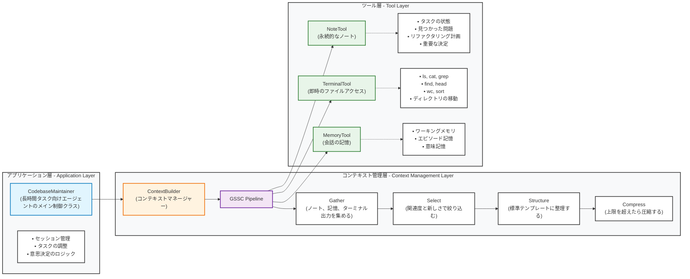

# Hello Agents 応用編 学習記録 - Task4

コース: [Hello Agents](https://github.com/datawhalechina/Hello-Agents)

## タスク

- 第 9 章
- 章末の練習問題

## ノート - 第 9 章 コンテキストエンジニアリング

### コンテキストエンジニアリングが重要な理由

LLM のコンテキストには限りがある。コンテキストが長くなるほど注意が分散し、モデルの性能が落ちる。これがコンテキストの劣化（context rot）

これまでの章のツールは、LLM が名前と説明をもとに選ぶ必要があり、記憶もプロンプトで LLM に渡して、モデルに参照させる必要がある

そのため、実行時間が長くなるほど、プロンプトで LLM に渡すものがたまっていく。コンテキストを管理しないと、背景情報だけでコンテキストが埋まったり、処理するものが多すぎて LLM の能力が落ちたりするかもしれない

#### 有効なコンテキストの「解剖学」

優れたコンテキストエンジニアリングの目標は、できるだけ少なく、しかしシグナル密度の高い tokens で、期待する結果が得られる確率を最大化すること

- システムプロンプト（System Prompt）: 明確で率直で、期待する振る舞いを完全に描き出せる「必要最小限の情報セット」
- ツール（Tools）:
  - 責務が単一で、互いの重なりが少なく、インターフェースの意味が明確
  - エラーに対して堅牢
  - 引数の説明が明確であいまいさがなく、モデルが得意な表現と推論の能力を十分に活かせる
- 例（Few-shot）: 多様で典型的な例を厳選し、「期待する振る舞い」を直接描き出す（ただし個人的には、偏りのある例はできるだけ選ばないほうがよいと思う。たとえば正誤を判断させるなら、結果が正しい例と誤っている例の両方を入れるのがよい）

#### コンテキストの検索とエージェント型検索

エンジニアリングの実践は、「推論前の一括検索（embedding 検索）」から「ジャストインタイム（Just-in-time, JIT）コンテキスト」へ少しずつ移りつつある

> 参照のメタデータそのものも振る舞いの洗練に役立つ。ディレクトリの階層、命名規則、タイムスタンプなどは、いずれも「目的と時効性」を暗に伝えている。たとえば、tests/test_utils.py と src/core/test_utils.py では意味するものが違う。

つまり、参照先のディレクトリだけを残しておき、必要なときにツールを呼び出して読み込む。段階的な開示を使う

ただしこれには、ツールやディレクトリ、命名などが誘導の役割を果たすように設計する必要がある。また開示の段階が 1 つ増えると、モデルは 1 ステップ多く考える必要があり、1 ステップ分の token と時間を余計に消費する。しかも一度選び間違えると、後の結果が誤ったり、無駄が出たりする可能性がある

そのため、最近 Microsoft が公開した TokenEconomizer には、失敗の繰り返しへの介入（agent が行き詰まったと判断したら、別のやり方を提案する）が含まれていて、token の消費を減らしている

#### 長時間タスクのためのコンテキストエンジニアリング

- 圧縮と統合（Compaction）: コンテキストを要約する。ただし重要な情報が失われる可能性があるので、まず再現率を最適化して取りこぼしを減らし、その後で精度を上げる
- 構造化ノート（Structured note-taking）:「エージェントの記憶」とも呼ばれる。情報を長期保存するファイルに書き込み、必要に応じて検索する
- サブエージェントアーキテクチャ（Sub-agent architectures）: タスクをコンテキストが分離されたサブエージェントに割り当て、途中の過程は省いて、結果だけをメインエージェントに返す。ただし token の消費が増えるので、サブエージェントを立ち上げる前に、今のタスクにその価値があるかを評価できるとよい

### Hello-Agents での実践: ContextBuilder

- 統一された入口:「収集（Gather）- 選択（Select）- 構造化（Structure）- 圧縮（Compress）」を再利用できる GSSC パイプラインとして抽象化する
- 安定した形: 骨格が固定されたコンテキストテンプレートを出力し、デバッグ、A/B テスト、評価をしやすくする
  - `[Role & Policies]`: Agent の役割と行動指針を明確にする
  - `[Task]`: 現在完了すべき具体的なタスク
  - `[State]`: Agent の現在の状態とコンテキスト情報
  - `[Evidence]`: 外部の知識ベースから検索した根拠となる情報
  - `[Context]`: 過去の会話と関連する記憶
  - `[Output]`: 期待する出力形式と要件
- 予算の保護: token の予算内でできるだけ価値の高い情報を残し、上限を超えたコンテキストにはフォールバックの圧縮戦略を用意する
- 最小限のルール: 出典や優先度などの分類の軸は導入せず、複雑さが増すのを避ける

#### コアのデータ構造

**ContextPacket: 候補となる情報のパケット**

- `content`: 情報の内容
- `timestamp`: タイムスタンプ
- `token_count`: Token 数
- `relevance_score`: 関連度スコア(0.0-1.0)
- `metadata`: 任意のメタデータ

**ContextConfig: 設定の管理**

- `max_tokens`: 最大 token 数
- `reserve_ratio`: システム指示のために確保する割合(0.0-1.0)
- `min_relevance`: 関連度の最低しきい値
- `enable_compression`: 圧縮を有効にするかどうか
- `recency_weight`: 新しさの重み(0.0-1.0)
- `relevance_weight`: 関連度の重み(0.0-1.0)

#### GSSC パイプラインの詳細

**Gather: 複数ソースからの情報収集**

- システム指示を ContextPacket に追加する（常に残す。`metadata` の `type` で区別する）
- 記憶から現在の会話に関連する記憶を検索し、ContextPacket に入れる
- RAG から関連する知識を検索し、ContextPacket に入れる
- 最近の会話履歴を追加する（デフォルトのウィンドウサイズは 5）
- 必要なものを自分で ContextPacket に追加することもできる

追加するときは try-except を使うので、1 つが失敗しても他の追加には影響しない

**Select: インテリジェントな情報の選択**

関連度と新しさにもとづいて候補の情報を採点し、選択する

- システム指示を切り離し、占める token 数を別に計算する
- それ以外の情報について総合スコアを計算する
  - 関連度の計算: 本番環境ではベクトル類似度の計算に置き換えられる
  - 新しさの計算: 指数減衰モデルを使い、24 時間以内は高いスコアを保ち、その後少しずつ減衰する
  - 総合スコア = 関連度の重み × 関連度 + 新しさの重み × 新しさ
  - 関連度の最低しきい値を下回る情報を除外する
  - 降順に並べる
- 貪欲法による選択: スコアの高い順に詰めていき、token の上限に達したら止める

**Structure: 構造化された出力**

`metadata` の `type` で区別する

- `[Role & Policies]`: Agent の役割と行動指針を明確にする
- `[Task]`: 現在完了すべき具体的なタスク
- `[State]`: Agent の現在の状態とコンテキスト情報
- `[Evidence]`: 外部の知識ベースから検索した根拠となる情報
- `[Context]`: 過去の会話と関連する記憶
- `[Output]`: 期待する出力形式と要件

**Compress: フォールバックの圧縮**

LLM による要約を使えるが、事前にブロックを分けておき、ブロックごとに圧縮して構造を保つ。こうすると情報の完全性をある程度保てる

#### ベストプラクティス

- token の予算を動的に調整する: 単純なタスクには小さい予算、複雑なタスクには大きい予算を使う
- 関連度の計算を最適化する: 単純なキーワードの重なりをベクトル類似度の計算に置き換え、検索の品質を上げる
- キャッシュの仕組み: 変わらないシステム指示や知識ベースの内容はキャッシュし、同じ計算を繰り返さないようにする
- モニタリングとログ: コンテキストを構築するたびに統計情報を記録し、後の最適化に役立てる
- A/B テスト: 重要なパラメータは A/B テストで最適な設定を探す

### NoteTool: 構造化ノート

- 構造化された記録: Markdown + YAML 形式を使い、機械での解析にも、人が読んだり編集したりするのにも向いている
- バージョン管理しやすい: プレーンテキスト形式なので、Git などのバージョン管理システムにそのまま対応できる
- オーバーヘッドが小さい: 複雑なデータベース操作が不要で、軽量な状態の追跡に向いている
- 柔軟な分類: type と tags でノートを柔軟に整理でき、さまざまな観点での検索に対応する

適した場面:
- 進捗や各種の指標を長期間記録する必要がある
- レポートやノートを作る必要がある
- ContextBuilder と組み合わせて、長期記憶の一種として使う

#### 保存形式の詳細

- ノートのファイル形式: Markdown
- インデックスファイル: ノートの目次として `notes_index.json` ファイルを管理する

#### コア操作の詳細

**create: ノートの作成**

1. ID を生成する: タイムスタンプつきのファイル名
2. `metadata` を作る: `id`、`title`、`type`、`tags`、`created_at`、`updated_at`
3. Markdown ファイルの内容を作って保存する
4. インデックスを更新する

**read: ノートの読み込み**

読み込んで解析し、YAML と本文を分ける

**update: ノートの更新**

タイトル、内容、タイプ、タグを更新する（タイムスタンプとインデックスはデフォルトで更新される）

**search: ノートの検索**

タイプとタグで絞り込める

**list: ノートの一覧**

index ファイルを使ってノートの一覧を出す

**summary: ノートの概要**

ノートの総数とタイプごとの数を集計し、最近更新された 5 件のノートを並べる

**delete: ノートの削除**

ノートのファイルとインデックスの項目を削除する

#### ベストプラクティス

1. ノートを適切に分類する:
   - `task_state`: 段階的な進捗と状態を記録する
   - `conclusion`: 重要な結論と発見を記録する
   - `blocker`: 進行を妨げている問題を記録する。優先度は最も高い
   - `action`: 次の行動計画を記録する
   - `reference`: 重要な参考資料を記録する
2. 定期的に整理してアーカイブする:
   - 解決済みの blocker は conclusion に更新する
   - 古くなった action はすぐに削除するか更新する
   - tags でバージョンを管理する。たとえば `["v1.0", "completed"]`
3. ContextBuilder と組み合わせる:
   - 会話の各ラウンドの前に関連するノートを検索する
   - ノートのタイプごとに異なる関連度スコアを設定する(blocker > action > conclusion)
   - ノートの数を制限し、コンテキストが過負荷にならないようにする
4. 人と機械の協働:
   - ノートは人が読める Markdown 形式で、手で編集できる
   - Git でバージョン管理し、ノートの変化を追跡する
   - 重要な段階では、Agent が作ったノートを人がレビューする
5. ワークフローの自動化:
   - ノートの概要レポートを定期的に作る
   - ノートをもとにプロジェクトの進捗ドキュメントを自動で作る
   - ノートの内容を他のシステム(Notion、Confluence など)に同期する

### TerminalTool: ファイルシステムへの即時アクセス

Agent にコマンドラインのコマンドを実行させて、コンピュータ上のファイルにアクセスできるようにする

利点: 前に述べたジャストインタイムのコンテキストと段階的な開示を実現できる

欠点: セキュリティ上の深刻なリスクがある。コンピュータ上のファイルがいつ誤って削除されてもおかしくない状態になり、機密ファイルにアクセスされる可能性もある

セキュリティの仕組み
- コマンドのホワイトリスト: 安全な読み取り専用のコマンドだけを許可し、システムを変更しうる操作は一切禁止する
  ```python
  ALLOWED_COMMANDS = {
      # ファイルの一覧と情報
      'ls', 'dir', 'tree',
      # ファイル内容の表示
      'cat', 'head', 'tail', 'less', 'more',
      # ファイルの検索
      'find', 'grep', 'egrep', 'fgrep',
      # テキスト処理
      'wc', 'sort', 'uniq', 'cut', 'awk', 'sed',
      # ディレクトリ操作
      'pwd', 'cd',
      # ファイルの情報
      'file', 'stat', 'du', 'df',
      # その他
      'echo', 'which', 'whereis',
  }
  ```
- 作業ディレクトリの制限(サンドボックス)
- タイムアウトの制御。リソースを際限なく使い続けるのを防ぐ
- 出力サイズの制限。コマンドの出力の大きさを制限し、メモリのオーバーフローを防ぐ

#### コア機能の詳細

**コマンドの実行**

`subprocess.run` でコマンドを実行する。結果にエラーが含まれていれば、それもまとめて返す
```python
def _execute_command(self, command: str) -> str:
    """コマンドを実行する"""
    try:
        # 現在のディレクトリでコマンドを実行する
        result = subprocess.run(
            command,
            shell=True,
            cwd=str(self.current_dir),  # 現在の作業ディレクトリで実行する(サンドボックス)
            capture_output=True,
            text=True,
            timeout=self.timeout,       # タイムアウトの制御
            env=os.environ.copy()
        )

        # 標準出力と標準エラーをまとめる
        output = result.stdout
        if result.stderr:
            output += f"\n[stderr]\n{result.stderr}"

        # 出力サイズを確認する(出力サイズの制限)
        if len(output) > self.max_output_size:
            output = output[:self.max_output_size]
            output += f"\n\n⚠️ 出力を切り詰めました（{self.max_output_size} バイトを超えています）"

        # リターンコードの情報を追加する
        if result.returncode != 0:
            output = f"⚠️ コマンドのリターンコード: {result.returncode}\n\n{output}"

        return output if output else "✅ コマンドの実行に成功しました（出力なし）"

    except subprocess.TimeoutExpired:
        return f"❌ コマンドの実行がタイムアウトしました（{self.timeout} 秒を超えています）"
    except Exception as e:
        return f"❌ コマンドの実行に失敗しました: {e}"
```

**ディレクトリの移動**

cd コマンドを特別に処理し、エージェントがファイルシステム内の別のディレクトリに移動できるようにする
- 相対パスを処理する
- 処理後のパスが作業ディレクトリの外に出ていないかを確認する（外に出ていればエラーメッセージを返す）
- ディレクトリが存在するかを確認する
- `self.current_dir` を移動先のパスに更新する

#### 典型的な使い方

- 探索的なナビゲーション
  1. プロジェクトのルートディレクトリを確認する
  2. ソースコードのディレクトリ構造を確認する
  3. 特定のパターンを検索する（grep）
- データファイルの分析: データファイルの構造と内容をすばやく把握する（csv の集計や確認ができる）
- ログファイルの分析: 日付で探したり、エラーの種類を集計したりできる
- コードベースの分析: コードレビューとコードの理解を補助する

#### 他のツールとの連携

- MemoryTool: TerminalTool で見つけた情報を記憶システムに保存できる
- NoteTool: 重要な発見を構造化ノートとして記録できる
- ContextBuilder: TerminalTool の出力をコンテキストの一部として使える

### 長時間タスク向けエージェントの実践: コードベース保守アシスタント



ContextBuilder + NoteTool + TerminalTool + MemoryTool を統合し、セッションをまたいでコードベース保守のタスクを管理する
1. 実行モードに応じて背景情報を読み込む
   - `auto`: ツールを使うかどうかを自動で判断する。`explore` と同じロジックを使う
   - `explore`: コードの探索を重視し、コードのディレクトリ構造を LLM に渡す
   - `analyze`: 問題の分析を重視し、コードの統計と、コード中の TODO や FIXME の印を LLM に渡す
   - `plan`: タスクの計画を重視し、最新 3 件のタスク状態ノート（`task_state`）のタイトルを LLM に渡す
2. 関連するノートを検索し、ノートのタイプごとに異なる関連度スコアを設定する
3. 最適化したコンテキストを構築する。実行モードに応じて異なるシステム指示を選ぶ
   - `auto`: システムに自動で判断してツールを選ぶよう求める
   - `explore`: システムにコードの探索を重視し、コードの構造を自分から把握して記録するよう求める
   - `analyze`: システムに問題の分析を重視し、コード中の TODO と FIXME を探し、コードの品質を評価して記録するよう求める
   - `plan`: システムにタスクの計画を重視し、過去のノートを振り返り、次の計画を立てて状態を更新するよう求める
4. LLM を呼び出す
5. 後処理
   - LLM の返答に含まれる `"问题", "bug", "错误", "阻塞"`（問題、バグ、エラー、ブロック）などの語を機械的に検出し、問題ノート（`blocker`）を作る
   - 上の語が見つからなかったときは、ユーザー入力に含まれる `"计划", "下一步", "任务", "todo"`（計画、次のステップ、タスク、todo）などの語を機械的に検出し、タスク計画ノート（`action`）を作る
6. 会話履歴を更新する

## 練習問題

1. この章では、コンテキストエンジニアリングとプロンプトエンジニアリングの違いを紹介した。次の点を分析せよ:

   - 9.1 節で「コンテキストは限られた資源と見なすべきで、限界効用は逓減する」と述べた。「コンテキストの劣化」（context rot）とはどのような現象か説明せよ。モデルが 100K、さらには 200K のコンテキストウィンドウに対応していても、なぜコンテキストを慎重に管理する必要があるのか？
     - LLM のコンテキストウィンドウがどれだけ大きくても、一度に多くのものを詰め込みすぎると、モデルの注意が薄まって能力が落ちるから。コンテキストの品質が悪い場合はなおさらで、モデルの出力に大きく影響する。
   - 50 個のファイルを含むコードベースを分析する「コードレビューアシスタント」を作るとする。（1）すべてのファイルの内容を一度にコンテキストに読み込む、（2）JIT（Just-in-time）コンテキストを使い、ツールで必要なファイルをその都度取得する、の 2 つの戦略を比較し、それぞれの長所と短所、適した場面を分析せよ。
     - 1 つ目
       - 長所: ツールを何度も呼び出してファイルを読む必要がないので、効率が上がる
       - 短所: ファイルが多すぎると、コンテキストの劣化が起きる
     - 2 つ目
       - 長所: 段階的な開示で、コンテキストを制御できる範囲に収められる
       - 短所: ツールを何度も呼び出してファイルを読む必要があり、間違ったファイルを見つけた場合は探し直すので、消費が増える
   - 9.2.1 節では、システムプロンプトの 2 つの極端な誤りとして「ハードコードしすぎ」と「漠然としすぎ」を挙げた。それぞれ実際の例を 1 つずつ挙げ、適切なバランスをどう見つけるか説明せよ。
     - ハードコードしすぎ: コードを解説する場面で
         ```
         質問に「何をするもの」や「どういう意味」が含まれていたら、対応する関数を探し、1 行ずつ説明する。
         質問に「どこ」や「どのファイル」が含まれていたら、grep -rn "<名前>" . を実行し、結果をそのまま返す。
         質問に「呼び出しの流れ」や「どう呼び出す」が含まれていたら、main 関数から始めて、呼び出し順に関数を並べる。
         質問に「なぜ」が含まれていたら、「疎結合にして、拡張と保守をしやすくするための設計です」と答える。
         質問に「エラーが出る」や「Error」が含まれていたら、「エラーメッセージを全文貼ってください」と返す。
         質問に「どう実行する」が含まれていたら、「先に pip install -r requirements.txt を実行し、次に python main.py を実行してください」と返す。
         どれにも当てはまらないときは、「どの関数について知りたいか教えてください」と返す。
         ```
       これだと、Java のプロジェクトの場合、モデルはどうすればいいかわからなくなる
     - 漠然としすぎ: コードを解説する場面で
       ```
       あなたはコードの専門家です。ユーザーの質問にわかりやすく答えてください
       ```
     - バランス:
       - ルールは書くが、具体的なトリガーワードは書かない
       - モデルが自分では知りえない情報を書く
       - ファイルは場所だけを伝え、Agent に自分で調べさせる
       - 背景、問題、調べ方、要件をモデルに伝える

2. GSSC（Gather-Select-Structure-Compress）パイプラインはこの章の中核となる技術である。次の点を深く考えよ:

   > <strong>ヒント</strong>：これは実践問題なので、実際に手を動かすことをすすめる

   - 9.3 節の ContextBuilder の実装では、4 つの段階がそれぞれ異なる責務を持つ。ある段階がうまく機能しなかった場合（Select 段階で関係のない情報を選んだ、Compress 段階で圧縮しすぎて情報が失われた、など）、最終的なエージェントの性能にどのような影響があるか分析せよ。
     - Gather: 集めたコンテキストに重要な情報の漏れがあると、最終的な出力が、ユーザーの過去の要望を忘れたように見える
     - Select: 関係のない情報を選ぶと、コンテキストの劣化が起きて出力の品質が下がる
     - Structure: 情報が構造化されていなくても、能力の高いモデルならあまり影響はなく、考えるときに情報を整理するために時間と token を少し余計に使う程度だと思う。ただし能力の高くないモデルでは、出力の品質に直接影響する
     - Compress: 圧縮しすぎて情報が失われると、失われた情報に関する質問にモデルが答えられなくなる
   - 9.3.4 節のコードをもとに、ContextBuilder に「コンテキストの品質評価」機能を追加せよ。コンテキストを構築するたびに、コンテキストの情報密度、関連度、完全性を自動で評価し、最適化の提案を出す。
     - （未完成）
   - GSSC パイプラインの「圧縮」段階では、LLM によるインテリジェントな要約を使っている。どのような場合に、単純な切り詰め（truncation）やスライディングウィンドウ（sliding window）の戦略のほうが LLM による要約より適しているか考えよ。複数の圧縮方法の利点を組み合わせたハイブリッドな圧縮戦略を設計せよ。
     - 単純な切り詰めが向いている場合:
       - コンテキストの大部分がツール呼び出しで、その結果をもう一度取得できる場合。たとえばすべてコマンドラインツールでファイルを読んでいるなら、コマンドだけを残せばコンテキストを空けられる
       - 質問同士に関連がない、または直近の数ラウンドの会話にしか関係しない場合（ただしこの判断は難しい）
       - 要約を誤ったときの代償が大きい場合。たとえばエラーメッセージや重要な決定に関する情報を含むとき
     - ハイブリッドな圧縮戦略:
       - 返ってきたツールの実行結果を、再現できるツールのコマンドに置き換える
       - 質問同士に関連がなければ、LLM にまっさらなコンテキストのサブエージェントを選ばせてタスクを任せ、結果だけを返させる
       - 重要な結果はファイルとして残し、ファイルのパスを記録する。コンテキストがいっぱいになっても、これらのファイルパスは変えない

3. NoteTool と TerminalTool は長時間タスクを支える重要なツールである。9.4 節と 9.5 節の内容をもとに、次の拡張の実践をせよ:

   > <strong>ヒント</strong>：これは実践問題なので、実際に手を動かすことをすすめる

   - NoteTool は階層的なノートシステム（プロジェクトノート、タスクノート、一時ノート）を使っている。一時ノートが一定数たまったときに、エージェントがそれらのノートを自動で分析し、重要な情報をタスクノートやプロジェクトノートに格上げして、冗長な内容を整理する「ノートの自動整理」の仕組みを設計せよ。
     - （未完成）
   - TerminalTool はファイルシステムを操作する能力を提供するが、9.5.2 節ではセキュリティの設計を強調している。現在のセキュリティの仕組み（パスの検証、コマンドのホワイトリスト、権限の確認）で十分か分析せよ。エージェントが機密ファイルにアクセスしたり危険な操作を実行したりする必要がある場合、「人と機械が協働する承認」のフローをどう設計すべきか？
     - （未完成）
   - NoteTool と TerminalTool を組み合わせて、コードベースの構造を分析し、リファクタリングの計画を記録し、リファクタリングを段階的に実行して、進捗と遭遇した問題をノートで追跡できる「インテリジェントなコードリファクタリングアシスタント」を設計せよ。ワークフローの全体図を描け。
     - （未完成）

4. 9.6 節の「長時間タスクの管理」の例では、コンテキストエンジニアリングが実際の応用で持つ価値を見た。次の点を深く分析せよ:

   - この例では「階層的なコンテキスト管理」の戦略として、即時アクセス（TerminalTool）+ セッションの記憶（MemoryTool）+ 永続的なノート（NoteTool）を使っている。この 3 つの層はどう連携すべきか？どの情報をどの層に置くべきか？情報の冗長と不整合をどう避けるか分析せよ。
     - 即時アクセスで実行したツールはワーキングメモリに記録する。永続的なノートに保存する必要があるものは意味記憶に 1 件追加するが、保存するのはノートのパスにする
     - 冗長と不整合を避けるには、どの情報も原本を 1 か所だけにし、他の場所には原本を指すパスを保存する。もともと記憶にあったものをノートに書く場合は、記憶のほうをノートのパスに置き換える
   - タスクの実行中に中断（システムのクラッシュやネットワークの切断など）が起き、エージェントがノートから状態を復元して実行を続ける必要があるとする。「中断箇所からの再開」の仕組みを設計せよ。ノートに十分な状態の情報をどう記録するか？復元した状態が正しいかをどう検証するか？
     - タスクごとに状態タグをつけ、bak ファイルを管理する。実行中のタスクごとに bak を 1 つ持ち、プログラムはツールを呼び出すたびと各ラウンドの終わりに上書きする。中断した後は bak ファイルを読み込み、bak が使える場合は、messages をコンテキストにつなげ、ワーキングメモリの記録を 1 件ずつ Memory に追加し直す
     - 復元した状態が正しいかをどう検証するか
       - bak にあるワーキングメモリの記録と、復元後のワーキングメモリを見比べ、件数と内容を照合する
       - 最新の即時ファイルアクセスのコマンドを確認し、実行した結果が bak の結果と同じかを見る
       - 状態タグが bak に記録された状態と同じかを確認する
   - 長時間タスクでは、複数のサブタスクを並列または直列に実行することが多い。タスク間の依存関係（「タスク B はタスク A が完了してから実行しなければならない」など）を表現でき、タスクの実行順を自動でスケジューリングする「タスクの依存関係管理」システムを設計せよ。このシステムを NoteTool とどう統合すべきか？
     - 計画ノートの各タスクに実行状態のタグと前提となる依存のタグをつける。これから実行するタスクに前提の依存があれば、その依存タスクの実行状態のタグを確認する。進行中か未着手なら現在のタスクは実行せず、そのタスクにさらに前提の依存があるかを探し続ける。最初の未完了の前提タスクが見つかったら、そこから順に実行する

5. この章では「段階的な開示」（progressive disclosure）の概念に何度も触れた。次の点を考えよ:

   - 9.2.2 節では、段階的な開示を「インタラクションの各ステップが新しいコンテキストを生み、それが次の判断を導く」と説明している。具体的な応用場面（学術論文の執筆、複雑な問題のデバッグなど）を設計し、段階的な開示がエージェントのタスクをより効率よく進める助けになることを示せ。
     - 学術論文の執筆の場面で、参考文献は `reference` フォルダに論文のタイトルをファイル名にして置き、実験関連の資料は `experiment` フォルダに、システム関連の資料は `system` フォルダに置く。

       Agent は論文を書くとき、すべてのファイルの内容をずっとコンテキストに入れておく必要はなく、それぞれのフォルダの場所がわかっていればよい。フォルダの場所を知らなくても、フォルダやファイルの名前が適切なら、最初にディレクトリをスキャンした時点で各フォルダに何が入っているかをおおよそ推測できる。

       LLM が考える過程で、ある種のファイルを探すと決めたときに、ツールで対応するパスのファイルを読む。こうするとコンテキストの空きを節約して、より重要なものを入れられ、コンテキストの劣化を防げる
   - 段階的な開示には「探索の効率が悪い」という潜在的なリスクがある。エージェントが重要でない細部に時間を使ったり、重要な情報を見逃したりするかもしれない。ヒューリスティックなルールやメタ認知の戦略で、エージェントが「次に何を探索すべきか」をより賢く決められるようにする「探索の誘導」の仕組みを設計せよ。
     - ツールの呼び出しが一定回数を超えたら、Agent にもっと具体的な検索に切り替えるよう求める
     - 1 ステップの結果を得るたびに、最初のタスクと進捗や計画を照らし合わせ、手順を変えるべきかを考えさせる
     - 質問と最終的に見つかったファイルパスを記録したファイルを管理し、似た質問がまた来たときはそのパスから直接アクセスできるようにする
   - 「段階的な開示」と従来の「すべてのコンテキストを一度に読み込む」方法を比較せよ。前者が明らかに有利なのはどのような種類のタスクか？後者のほうが適しているのはどのような種類のタスクか？種類の異なるタスクの例を少なくとも 3 つ挙げよ。
     - 段階的な開示: 保存場所がはっきりしていて、読むものが多いタスク。たとえば:
       - コード分析の Agent がコード全体を分析するタスク
       - 論文執筆の Agent が参考文献と照らし合わせて本文の内容を確認するタスク
       - 研究用の Agent が資料を検索して新規性の分析レポートを書くタスク
     - すべてのコンテキストを一度に読み込む方法: 参考資料があまり必要ない場合や、全文を読む必要がある場合。たとえば:
       - Agent にある口調で話させるタスク
       - Agent に、生成した返答が 5 つのルールを満たしているかを確認させるタスク
       - Agent に数千字の短い文章を翻訳させたり、推敲させたりするタスク
